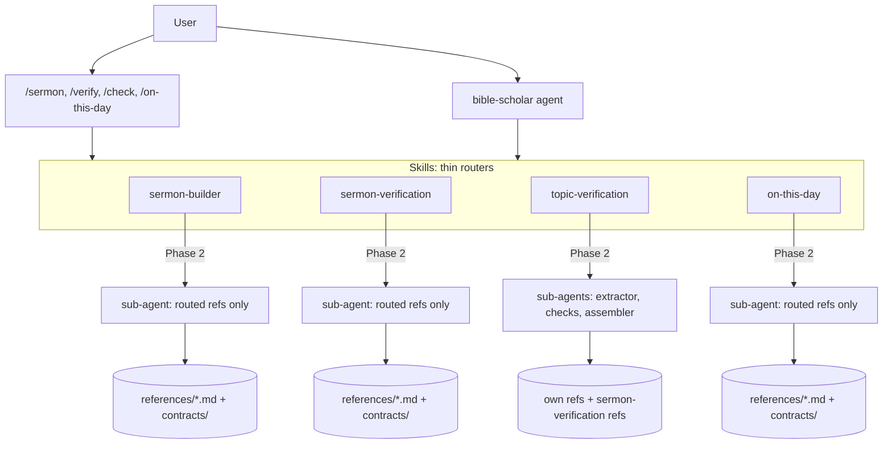
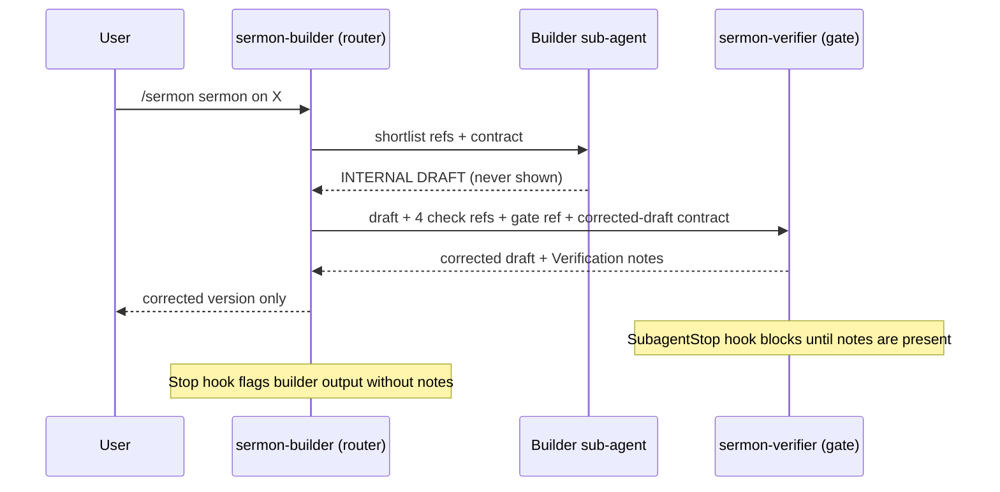
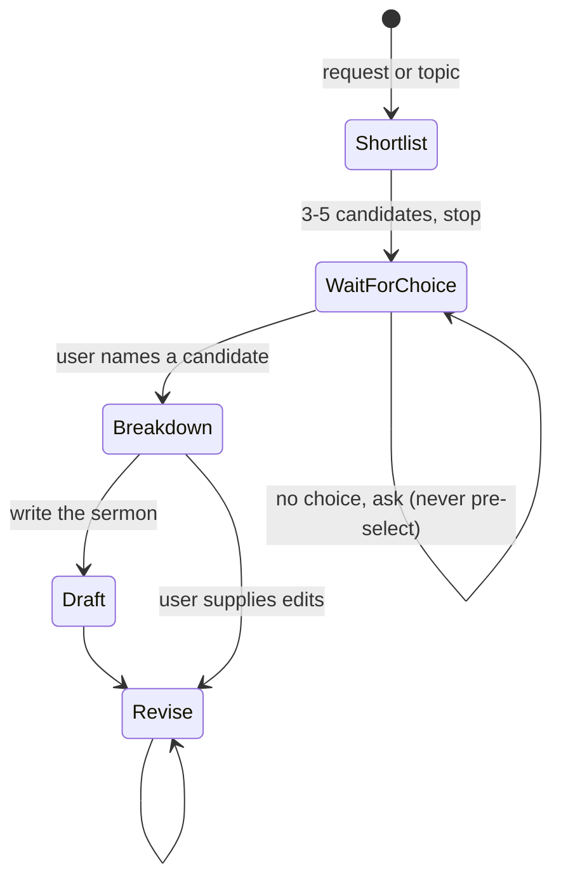

# bible-research Architecture

Internal design for contributors. For decisions and deviations see [DESIGN_NOTES.md](DESIGN_NOTES.md).

## Layers



## The Gate



## sermon-builder state



## Routing

| Skill | Task type | References loaded |
|---|---|---|
| sermon-builder | shortlist | exegesis-method, plain-language-style |
| sermon-builder | breakdown | exegesis-method, original-language, jewish-sources, homiletical-structure, plain-language-style |
| sermon-builder | draft | homiletical-structure, original-language, plain-language-style |
| sermon-builder | revise | homiletical-structure, plain-language-style |
| sermon-verification | cite / history / doctrine / redteam / pacing | its own single reference |
| sermon-verification | gate | the four checks + pre-delivery-gate (never oral-delivery) |
| topic-verification | song / web / post / transcript / full | claim-extraction + the type reference(s); each check reuses one sermon-verification reference |
| on-this-day | liturgical / history / hebrew / all | its own reference(s); Hebrew only on request |

## Hooks

| Event | Matcher | Effect |
|---|---|---|
| SubagentStop | `.*sermon-verifier` | `gate_check.py verifier`: blocks the verifier from finishing unless its output ends in Verification notes, has no `INTERNAL DRAFT` marker and no per-check report |
| Stop | all | `gate_check.py stop`: blocks a main-thread reply that delivers sermon-builder output (shortlist or breakdown markers) without Verification notes; allows everything else |

Hooks are deterministic command hooks and can block or continue only; they cannot rewrite output. Tests: `tests/test_gate_check.py`.

## Layout

```
bible-research/
  .claude-plugin/plugin.json
  agents/        bible-scholar.md, sermon-verifier.md
  commands/      sermon.md, verify.md, check.md, on-this-day.md
  hooks/         hooks.json, gate_check.py
  tests/         test_gate_check.py
  skills/
    sermon-builder/        SKILL.md, references/ (5), references/contracts/ (3)
    sermon-verification/   SKILL.md, references/ (6), references/contracts/ (6)
    topic-verification/    SKILL.md, references/ (4), references/contracts/ (1)
    on-this-day/           SKILL.md, references/ (3), references/contracts/ (1)
```
