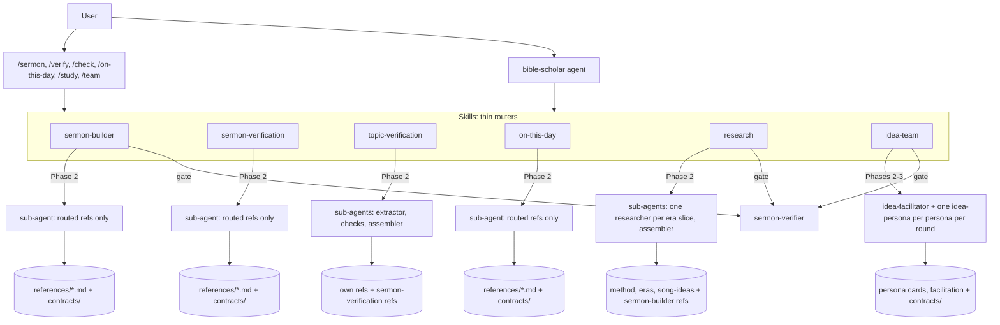
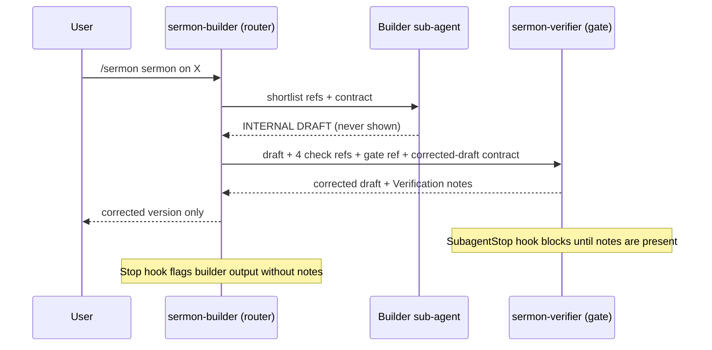
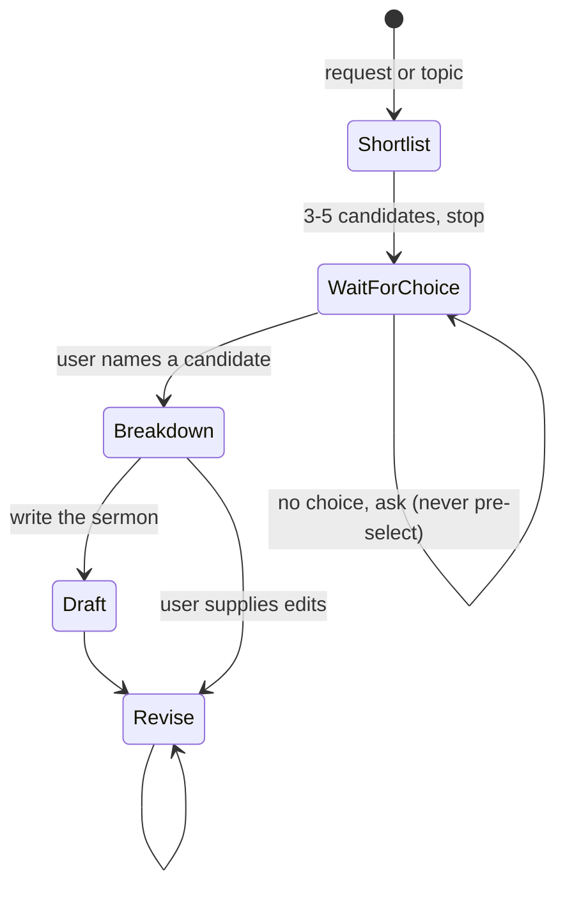

# bible-research Architecture

Internal design for contributors. For decisions and deviations see [DESIGN_NOTES.md](DESIGN_NOTES.md).

## Layers



## Idea-team rounds (isolation with bounce)

```mermaid
sequenceDiagram
    participant U as User
    participant IT as idea-team (router)
    participant F as idea-facilitator
    participant P as idea-persona x N (fresh agent each round)
    participant V as sermon-verifier
    U->>IT: /team review "idea"
    IT->>F: facilitation.md + idea
    F-->>IT: frame
    IT->>P: round 1: card + frame (parallel, one message)
    P-->>IT: persona entries
    IT->>IT: attributed round digest
    IT->>P: round 2: card + frame + digest (fresh agents)
    P-->>IT: agree / rebut / refine / changed mind (reason)
    Note over IT: at least 2 rounds; continue while positions move, up to the cap (default 3, max 4)
    IT->>F: all digests + report contract
    F-->>IT: INTERNAL DRAFT report
    IT->>V: report + gate refs
    V-->>IT: corrected report + Verification notes
    IT-->>U: report only
```

## The Gate



## sermon-builder state



## Routing

| Skill | Task type | References loaded |
|---|---|---|
| sermon-builder | shortlist | exegesis-method, plain-language-style |
| sermon-builder | breakdown | exegesis-method, original-language, jewish-sources, homiletical-structure, plain-language-style |
| sermon-builder | draft | homiletical-structure, original-language, plain-language-style |
| sermon-builder | revise | homiletical-structure, plain-language-style |
| sermon-verification | cite / history / doctrine / redteam / pacing | its own single reference |
| sermon-verification | gate | the four checks + pre-delivery-gate (never oral-delivery) |
| topic-verification | song / web / post / transcript / full | claim-extraction + the type reference(s); each check reuses one sermon-verification reference |
| on-this-day | liturgical / history / hebrew / all | its own reference(s); Hebrew only on request |
| research | timeline / song-ideas | research-method, source-tiers, timeline-eras (chosen era sections only; one researcher per slice; at most three eras per batch), song-ideas for ideas (researcher for one slice, assembler for several); then the gate |
| research | word-study / person / theme-trace / passages / church-history | research-method, source-tiers, plus one reused sermon-builder or on-this-day reference; then the gate |
| idea-team | review | selected persona cards (one per agent), facilitation; round digests; then the gate for the report |
| idea-team | talk | selected persona cards, facilitation (frame; the router keeps the running summary); talk turns are not gated, `summary` is |

## Hooks

| Event | Matcher | Effect |
|---|---|---|
| SubagentStop | `.*sermon-verifier` | `gate_check.py verifier`: blocks the verifier from finishing unless its output ends in Verification notes, has no `INTERNAL DRAFT` marker and no per-check report |
| Stop | all | `gate_check.py stop`: blocks a main-thread reply that delivers gated output (sermon-builder shortlist or breakdown markers; a `Timeline`, `Song Ideas`, `Idea Review` or `Research Findings` top-level heading **together with** its contract header line, `**Eras covered:**`, `**Personas:**` or `**Question shape:**`) without Verification notes; allows everything else, including the era pick list, talk turns and another plugin's `# Timeline:` |

Hooks are deterministic command hooks and can block or continue only; they cannot rewrite output. Tests: `tests/test_gate_check.py`.

## Layout

```
bible-research/
  .claude-plugin/plugin.json
  agents/        bible-scholar.md, sermon-verifier.md, idea-persona.md, idea-facilitator.md
  commands/      sermon.md, verify.md, check.md, on-this-day.md, study.md, team.md
  hooks/         hooks.json, gate_check.py
  tests/         test_gate_check.py
  skills/
    sermon-builder/        SKILL.md, references/ (5), references/contracts/ (3)
    sermon-verification/   SKILL.md, references/ (6), references/contracts/ (6)
    topic-verification/    SKILL.md, references/ (4), references/contracts/ (1)
    on-this-day/           SKILL.md, references/ (3), references/contracts/ (1)
    research/              SKILL.md, references/ (4), references/contracts/ (3)
    idea-team/             SKILL.md, references/ (3), references/contracts/ (3)
```
