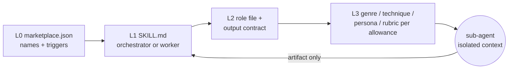
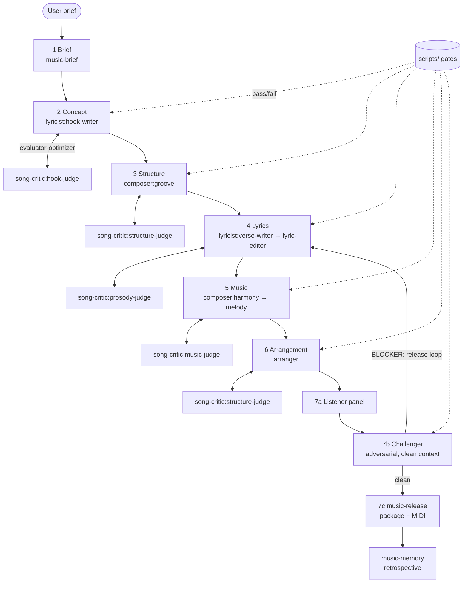

# music-team — Implementation Plan

> Status: **PROPOSED, revision 4 (renamed from song-team; waves 2–5 superseded — see §17 note)** (after two rounds of delivery-team review: Architect, Product Owner, QA, Tech Writer) · Author: Claude (with Michael Connelly) · Date: 2026-10-22
> Target plugin directory: `music-team/` · Marketplace ID: `music-team`
> Patterns borrowed from: `delivery-team/` (orchestrator + role-scoped workers + hooks), `mtg-commander/` (adversarial challengers, config-driven loops), `hardware-team/` (domain pipeline over a tool layer).
> Lifecycle: this plan is superseded by `music-team/ARCHITECTURE.md` once Wave 5 lands; until then it is the design source of truth.

This document is the complete, self-contained plan for building a song-creation agent plugin. Every component, file, stage, hook, script, and governance obligation is specified here so a contributor can implement it wave by wave without re-deriving the design.

---

## Table of Contents

1. [Goals and Non-Goals](#1-goals-and-non-goals)
2. [Design Principles](#2-design-principles)
3. [Progressive Disclosure Model](#3-progressive-disclosure-model)
4. [Plugin Layout](#4-plugin-layout)
5. [Skill Roster](#5-skill-roster)
6. [The `music-flow` Pipeline](#6-the-music-flow-pipeline)
7. [Song Type Auto-Detection and Routing Matrix](#7-song-type-auto-detection-and-routing-matrix)
8. [Collaboration Patterns](#8-collaboration-patterns)
9. [Artifacts and Output Contracts](#9-artifacts-and-output-contracts)
10. [Configuration Schema (`.song/config.yml` v1)](#10-configuration-schema-songconfigyml-v1)
11. [Hooks](#11-hooks)
12. [Scripts](#12-scripts)
13. [Reference Library (Progressive Disclosure Content)](#13-reference-library-progressive-disclosure-content)
14. [Memory and Self-Learning](#14-memory-and-self-learning)
15. [Guardrails: Originality and Copyright](#15-guardrails-originality-and-copyright)
16. [Governance Obligations](#16-governance-obligations)
17. [Implementation Waves](#17-implementation-waves)
18. [Definition of Done per Wave](#18-definition-of-done-per-wave)
19. [Risks and Mitigations](#19-risks-and-mitigations)
20. [Open Questions](#20-open-questions)
21. [Appendix A — Example Session Walkthrough](#appendix-a--example-session-walkthrough)
22. [Appendix B — Sub-Agent Prompt Template](#appendix-b--sub-agent-prompt-template)
23. [Appendix C — Review Log](#appendix-c--review-log)

---

## 1. Goals and Non-Goals

### Goals

- Deliver a **full song** (title, lyric sheet, chord chart, melody sketch, arrangement notes, production brief) from a one-line brief, through a staged pipeline with quality gates.
- Mirror the delivery-team architecture so contributors already familiar with `delivery-flow` can navigate `music-flow` immediately: one orchestrator, role-scoped worker skills, sub-agents with isolated context, hooks, config, memory.
- Load song-craft knowledge **progressively**: genre, role, and task references enter a sub-agent's context only when that sub-agent needs them. Never load the whole craft library at once.
- Produce **machine-checkable** artifacts where possible (ABC notation for melody, a structured lyric sheet with section tags, a chord chart in Roman numerals plus concert pitch) so hooks and scripts can validate rather than merely eyeball.
- Be **deterministic at the gates**: pass/fail decisions on prosody, rhyme scheme, structure, energy curve, challenger severity, and originality are rule-based (scripts), not vibes.
- Ship **user value early**: a lyric-only song is producible end-to-end by the third PR (see [§17](#17-implementation-waves), story W2-5).

### Non-Goals

- Audio rendering, mixing, or mastering. The pipeline ends at a production brief plus a MIDI/ABC sketch. DAW work is out of scope.
- Reproducing or closely imitating specific copyrighted songs or artists' lyrics. See [§15](#15-guardrails-originality-and-copyright).
- Music-theory tutoring as a primary purpose. Theory references exist to serve the pipeline, not as a standalone course.
- Replacing `delivery-team`. `music-team` is a sibling plugin, not a sub-skill of delivery-flow.
- **Non-English lyrics at v1.** The syllable, stress, and rhyme heuristics are English-only. Other languages run the pipeline with those gates reporting `SKIPPED`, not `FAIL`. See [§12](#12-scripts) and [§20](#20-open-questions).

---

## 2. Design Principles

These are lifted from `delivery-team/references/shared/orchestrator-doctrine.md` and adapted.

1. **Orchestrator never writes the song.** `music-flow` coordinates stages and gates. Every lyric line, chord, and melody note is produced by a worker skill running as a sub-agent.
2. **Context isolation by role and genre.** A lyricist sub-agent working on a country ballad loads `lyricist/references/genres/country.md` and nothing about hip-hop. A composer sub-agent for the same song loads `composer/references/genres/country.md` and nothing about lyrics.
3. **Evaluator-optimizer at every creative stage.** A worker produces, a critic evaluates against an explicit rubric, the worker revises. Loop caps are configurable; exhaustion follows the configured escalation policy.
4. **Adversarial re-verification before release.** A challenger sub-agent with a clean context attempts to break the song (cliché density, prosody collisions, structural monotony, accidental resemblance to known works) before the final gate.
5. **Deterministic gates.** Scripts decide pass/fail on measurable properties. Sub-agents interpret and improve; they never self-certify and never override a gate. Only the user may override, and the override is recorded.
6. **One gate runner.** The orchestrator's stage protocol (step 4) is the only place a gate decides a loop. Hooks that run gate scripts are advisory and feed the same result; they never block independently.
7. **Everything on disk.** Every stage writes to `.song/<song-slug>/` so a session can resume, a retrospective can read it, and memory can learn from it.
8. **Budgeted SKILL.md files.** Tier A/B/C line budgets apply exactly as in `governance/skill-budgets.json`. Depth lives in `references/`.

---

## 3. Progressive Disclosure Model

Four levels, each loaded strictly later than the previous.

| Level | What loads | When | Where |
|-------|-----------|------|-------|
| L0 — Metadata | Plugin + skill names, descriptions, trigger phrases | Always (marketplace index) | `.claude-plugin/marketplace.json` |
| L1 — Skill body | `SKILL.md` of the triggered skill (orchestrator or worker) | When the skill triggers | `music-team/skills/<skill>/SKILL.md` |
| L2 — Role / task reference | One role file + one output contract | When the worker dispatches a sub-agent for a specific task | `skills/<skill>/references/roles/`, `references/contracts/` |
| L3 — Genre / technique reference | Genre, technique, persona, or rubric files per the role's allowance | Loaded inside the sub-agent prompt only | `skills/<skill>/references/genres/`, `techniques/`, `personas/`, `rubrics/` |

**Prompt allowance manifest.** Each role has an explicit allowance in `references/shared/prompt-allowances.json` listing which reference directories it may embed and how many files from each. The default allowance for creative roles is: one role file, one contract, one genre file, at most two technique files. `listener-panel` is allowed three persona files; `challenger` is allowed the originality policy, the blocked-targets list, and the cliché list. The memory lessons block ([§14](#14-memory-and-self-learning)) and the originality clause ([§15](#15-guardrails-originality-and-copyright)) are exempt from counting. `audit_agent_prompt.py` enforces the manifest ([§11](#11-hooks)).

```json
{
  "schema_version": 1,
  "defaults": { "roles": 1, "contracts": 1, "genres": 1, "techniques": 2, "personas": 0, "rubrics": 0, "shared": 0 },
  "roles": {
    "listener-panel": { "personas": 3, "genres": 0, "techniques": 0 },
    "challenger":     { "shared": 3, "genres": 0, "techniques": 0 },
    "hook-judge":     { "rubrics": 1, "techniques": 1 },
    "music-judge":    { "rubrics": 1, "techniques": 1 },
    "prosody-judge":  { "rubrics": 1, "techniques": 1 },
    "structure-judge":{ "rubrics": 1, "techniques": 1 }
  },
  "exempt_blocks": ["originality-policy", "memory-lessons"]
}
```

**Shared references** (`music-team/references/shared/`) are the only files the orchestrator itself may load, and only the doctrine, stage-gate table, routing matrix, and config schema.



---

## 4. Plugin Layout

```text
music-team/
├── README.md                       # user-facing: install, triggers, example sessions
├── ARCHITECTURE.md                 # contributor-facing: Mermaid diagrams, dispatch tables
├── CROSS-SKILL-REFERENCES.md       # which skill may load which shared reference; duplicated files listed
├── LICENSE.txt
├── .song.config.yml.example        # template copied to user repo as .song/config.yml by music-brief
├── agents/                         # named sub-agent definitions so SubagentStop matchers fire
│   ├── lyricist.md
│   ├── composer.md
│   ├── arranger.md
│   └── song-critic.md
├── hooks/
│   ├── hooks.json
│   ├── check_config.py             # SessionStart: warn if .song/config.yml missing/stale
│   ├── audit_agent_prompt.py       # PreToolUse(Agent): allowance manifest + originality clause + blocked targets
│   ├── validate_artifacts.py       # PostToolUse(Write|Edit): lint .song artifacts, advisory
│   ├── gate_subagent.py            # SubagentStop: run stage gate, write result to state.json, advisory
│   ├── telemetry.py                # PreToolUse(Skill): skill-load telemetry (Wave 5, optional)
│   └── verify_skill_load.py        # PostToolUse(Agent): SKILL_LOADED marker check (Wave 5, optional)
├── scripts/
│   ├── gate_common.py              # shared CLI/JSON/exit-code contract used by every gate script
│   ├── prosody_check.py            # syllable + stress alignment vs. section meter spec; --hook mode
│   ├── rhyme_check.py              # rhyme-scheme conformance, slant-rhyme tolerance
│   ├── structure_check.py          # section order/length vs. form template; --consistency mode
│   ├── arrangement_check.py        # energy-curve rule
│   ├── chord_tools.py              # key/scale validation, Roman <-> concert pitch, cadence lint
│   ├── abc_validate.py             # ABC notation parser + range/interval sanity; lyric alignment when lyrics exist
│   ├── midi_export.py              # ABC -> .mid (stdlib-only byte writer)
│   ├── cliche_scan.py              # phrase-frequency scan against references/shared/cliche-list.txt
│   ├── resemblance_check.py        # n-gram overlap against user-supplied "do-not-resemble" corpus
│   ├── challenge_gate.py           # parses challenge-report severity table; fails on BLOCKER > 0
│   └── check_reference_caps.py     # plugin-local lint: references/** line caps + duplicated-file drift
├── references/
│   └── shared/
│       ├── orchestrator-doctrine.md
│       ├── stage-gates.md          # gate table + the exact rules every script implements
│       ├── config-schema.md        # single source of truth for .song/config.yml (v1)
│       ├── song-types.md           # detection signals + the routing matrix
│       ├── prompt-allowances.json  # per-role reference allowance (see §3)
│       ├── originality-policy.md   # the copyright guardrail, quoted verbatim in every prompt
│       ├── blocked-targets.txt     # artist names and song titles that may not be style targets
│       ├── artifact-formats.md     # lyric sheet, chord chart, ABC, production brief, challenge report specs
│       ├── cliche-list.txt
│       └── glossary.md
├── skills/
│   ├── music-flow/                  # Tier A — orchestrator
│   ├── music-brief/                 # Tier C — intake + concept; writes config if absent
│   ├── lyricist/                   # Tier B — roles: hook-writer, verse-writer, lyric-editor
│   ├── composer/                   # Tier B — roles: harmony, melody, groove
│   ├── arranger/                   # Tier B — roles: instrumentation, dynamics, production-brief
│   ├── song-critic/                # Tier B — roles: hook-judge, prosody-judge, structure-judge, music-judge, listener-panel, challenger
│   ├── music-release/               # Tier C — assembles final package, exports MIDI, writes release notes
│   └── music-memory/                # Tier C — retrospective + memory write (post-pipeline protocol)
└── tests/
    ├── unit/                       # one test module per script; run: python -I -m unittest discover tests/unit
    ├── fixtures/
    │   ├── prosody-gold/           # >= 200 hand-labelled original lines (syllables + stress)
    │   ├── briefs/                 # one brief per routing row (8) for detection tests
    │   ├── songs/<type>/           # one complete passing .song/<slug>/ artifact set per song type
    │   └── negative/               # malformed ABC, mismatched tags, empty lyrics, wrong-key chords, w: misalignment, with expected JSON
    └── smoke/                      # 7-sample baseline (6 types + 1 refusal; REVISE excluded, needs a prior run); baseline.json
```

Each `skills/<name>/` directory follows:

```text
skills/<name>/
├── SKILL.md
└── references/
    ├── roles/            # one file per role (L2)
    ├── contracts/        # output contracts, one per task type (L2)
    ├── genres/           # one file per genre (L3)
    ├── techniques/       # craft techniques (L3)
    ├── rubrics/          # song-critic only (L3)
    ├── personas/         # song-critic only (L3)
    └── agent-prompts/    # sub-agent prompt templates per task type
```

**Agent definitions.** `agents/*.md` are thin named agents (frontmatter `name`, `description`, `tools`) whose body is the Appendix B skeleton. The orchestrator dispatches with `subagent_type` set to one of them so the `SubagentStop` matcher in [§11](#11-hooks) fires. Role and reference content is still injected per dispatch; the agent file carries no craft knowledge.

---

## 5. Skill Roster

| Skill | Tier | Budget | Role | Dispatches sub-agents? | Primary triggers |
|-------|------|--------|------|------------------------|------------------|
| `music-flow` | A | 500 | Orchestrator; runs the 7-stage pipeline, owns gates and loops | Yes (all workers) | "write a song", "song pipeline", "make me a song", "compose a song", "full song", "song from scratch", "revise the song" |
| `music-brief` | C | 200 | Intake wizard; writes config if absent; produces the Brief artifact; detects song type | No (runs inline) | "song brief", "song idea", "what should the song be about" |
| `lyricist` | B | 300 | Hook, verse, pre-chorus, bridge lyrics; editing passes | Yes, role-scoped | "write lyrics", "chorus lyrics", "verse", "rewrite this lyric", "hook line", "rhyme this" |
| `composer` | B | 300 | Chord progressions, melody (ABC), groove/tempo | Yes, role-scoped | "chord progression", "write a melody", "key and tempo", "harmonize", "topline" |
| `arranger` | B | 300 | Instrumentation, section dynamics, production brief | Yes, role-scoped | "arrangement", "instrumentation", "production notes", "build the drop", "string arrangement" |
| `song-critic` | B | 300 | Rubric-driven critique, listener personas, adversarial challenger | Yes, role-scoped | "critique this song", "is this lyric good", "prosody check", "listener feedback", "song review" |
| `music-release` | C | 200 | Assembles the final package; runs exports; writes release notes | No | "export the song", "finalize song", "song package", "lead sheet" |
| `music-memory` | C | 200 | Retrospective + memory write; enforced by Stop hook | No | "song retrospective", "what did we learn" |

Each worker SKILL.md contains exactly: frontmatter (same keys as delivery-team: `tier`, `context_budget`, `fitness_review_due`, `maintainer`, `allowed-tools`), a **Design Principle** block, a **Role Detection** table, a **Dispatch Protocol** (which reference files to embed for which role, matching the allowance manifest), the **Output Contract** pointer, and a **Hand-off** section. Everything else lives in `references/`.

Standalone invocation of a worker skill outside `music-flow` **warns** that gates will not run (it does not deny; see [§20](#20-open-questions) item 5).

### Role tables per worker

**lyricist**

| Role | Detect when | Loads (L2) | Loads (L3) |
|------|-------------|-----------|-----------|
| `hook-writer` | task is chorus/hook/title line | `roles/hook-writer.md`, `contracts/hook.md` | `genres/<g>.md`, `techniques/hook-craft.md`, `techniques/prosody.md` |
| `verse-writer` | task is verse/pre-chorus/bridge | `roles/verse-writer.md`, `contracts/section-lyric.md` | `genres/<g>.md`, `techniques/imagery-and-specificity.md`, `techniques/rhyme-schemes.md` |
| `lyric-editor` | task is revise/tighten/fix-prosody | `roles/lyric-editor.md`, `contracts/revision.md` | `genres/<g>.md`, `techniques/prosody.md`, `techniques/cliche-avoidance.md` |

**composer**

| Role | Detect when | Loads (L2) | Loads (L3) |
|------|-------------|-----------|-----------|
| `harmony` | task is chords/progression/key | `roles/harmony.md`, `contracts/chord-chart.md` | `genres/<g>.md`, `techniques/functional-harmony.md`, `techniques/borrowed-chords.md` |
| `melody` | task is melody/topline | `roles/melody.md`, `contracts/melody-abc.md` | `genres/<g>.md`, `techniques/melodic-contour.md`, `techniques/abc-notation-primer.md` |
| `groove` | task is tempo/feel/rhythm/form | `roles/groove.md`, `contracts/structure.md` | `genres/<g>.md`, `techniques/rhythmic-feel.md`, `techniques/form-templates.md` |

**arranger**

| Role | Detect when | Loads (L2) | Loads (L3) |
|------|-------------|-----------|-----------|
| `instrumentation` | task is instruments/palette | `roles/instrumentation.md`, `contracts/arrangement-map.md` | `genres/<g>.md`, `techniques/section-contrast.md` |
| `dynamics` | task is energy curve/build/drop | `roles/dynamics.md`, `contracts/arrangement-map.md` | `genres/<g>.md`, `techniques/energy-curve.md` |
| `production-brief` | task is notes for a producer/DAW | `roles/production-brief.md`, `contracts/production-brief.md` | `genres/<g>.md`, `techniques/reference-track-language.md` |

**song-critic**

| Role | Detect when | Loads (L2) | Loads (L3) |
|------|-------------|-----------|-----------|
| `hook-judge` | after Stage 2 (Concept) | `roles/hook-judge.md`, `contracts/critique.md` | `rubrics/hook-rubric.md`, `techniques/hook-craft.md` |
| `prosody-judge` | after Stage 4 (Lyrics) | `roles/prosody-judge.md`, `contracts/critique.md` | `rubrics/lyric-rubric.md`, `techniques/prosody.md` |
| `structure-judge` | after Stages 3 and 6 | `roles/structure-judge.md`, `contracts/critique.md` | Stage 3: `rubrics/structure-rubric.md`, `techniques/form-templates.md`; Stage 6: `rubrics/arrangement-rubric.md`, `techniques/form-templates.md` |
| `music-judge` | after Stage 5 (Music) | `roles/music-judge.md`, `contracts/critique.md` | `rubrics/melody-rubric.md`, `techniques/melodic-contour.md` |
| `listener-panel` | Stage 7a; review-board pattern | `roles/listener-panel.md`, `contracts/panel-report.md` | `personas/<3 selected>.md` |
| `challenger` | Stage 7b; adversarial pass | `roles/challenger.md`, `contracts/challenge-report.md` | `shared/originality-policy.md`, `shared/blocked-targets.txt`, `shared/cliche-list.txt` |

---

## 6. The `music-flow` Pipeline

Seven stages, mirroring delivery-flow's count so the mental model transfers. Which stages run, and at what depth, is decided by the routing matrix in [§7](#7-song-type-auto-detection-and-routing-matrix). Every gate names its script and its config threshold; the exact rules are written in `references/shared/stage-gates.md` (W0-2) and implemented by the scripts in [§12](#12-scripts).

| # | Stage | Owner role(s) | Critic role | Produces | Gate script(s) | Threshold key |
|---|-------|---------------|-------------|----------|----------------|---------------|
| 1 | **Brief** | `music-brief` (inline) | — | `brief.md`; `.song/config.yml` if absent | brief validation (theme required; song type detected; language set) | — |
| 2 | **Concept** | `lyricist:hook-writer` | `hook-judge` | `concept.md` (title, hook line, central image, arc) | `cliche_scan.py`; `prosody_check.py --hook` | `quality.cliche_max_per_100_words`, `quality.hook_max_syllables` |
| 3 | **Structure** | `composer:groove` | `structure-judge` | `structure.md` (form, bar counts, tempo, key, time sig, per-section meter spec) | `structure_check.py` | form template in `techniques/form-templates.md` |
| 4 | **Lyrics** | `lyricist:verse-writer` then `lyricist:lyric-editor` | `prosody-judge` | `lyrics.md` | `prosody_check.py`, `rhyme_check.py`, `cliche_scan.py` | `quality.prosody_tolerance`, `quality.slant_rhyme_allowed`, `quality.cliche_max_per_100_words` |
| 5 | **Music** | `composer:harmony` then `composer:melody` | `music-judge` | `chords.md`, `melody.abc` | `chord_tools.py`, `abc_validate.py` | `quality.diatonic_min_ratio`, `quality.max_melodic_leap`, `quality.vocal_range` |
| 6 | **Arrangement** | `arranger` (instrumentation → dynamics → production-brief) | `structure-judge` | `arrangement.md`, `production-brief.md` | `arrangement_check.py`, `structure_check.py --consistency` | `quality.energy_curve` |
| 7 | **Release** | `song-critic:listener-panel` → `song-critic:challenger` → `music-release` | — | `panel-report.md`, `challenge-report.md`, `package/` | `challenge_gate.py`, `resemblance_check.py` (when corpus configured) | `originality.ngram_max_overlap` |



### Stage execution protocol (identical for every stage)

1. Orchestrator reads `.song/config.yml` (created in Stage 1 if absent) and `.song/<slug>/state.json`.
2. Orchestrator builds a sub-agent prompt from the worker's `agent-prompts/<task>.md` template, embedding only the files permitted by the allowance manifest, and dispatches with `subagent_type` set to the matching `agents/*.md` definition.
3. Sub-agent writes the artifact to `.song/<slug>/<artifact>` and returns the Appendix B hand-back (first line `SKILL_LOADED:`, then STATUS / ARTIFACT / SUMMARY).
4. **Gate decision (single runner).** The orchestrator reads `state.json.gates[<stage>]`. If the `SubagentStop` hook pre-populated it in this dispatch and the recorded `artifact_sha256` matches the artifact on disk, the orchestrator reuses that result; otherwise (hook disabled, crashed, standalone invocation, or hash mismatch) it runs the gate script(s) itself via `gate_common.py` and writes the result. Either way this step is the **only** gate decision point. On FAIL it dispatches the stage's critic role with the script output as evidence, then re-dispatches the worker with the critique, incrementing `state.json.loops_used[<stage>]`. On SKIPPED (non-English gates) it proceeds as PASS and logs the skip.
5. On reaching `loops.<stage>`, apply `escalation.on_loop_exhaustion`:
   - `ask_user`: show the last three attempts and the gate diff; the user picks accept, override (recorded in `state.json.gate_overrides[]` and `decisions.md`), or supply guidance (resets the stage counter once).
   - `accept_best`: keep the attempt with the best gate metrics, record `accepted_best: true` for the stage, proceed.
   - `fail`: stop the run and write `state.json.status = "failed"`.
6. Orchestrator updates `state.json` and proceeds to the next stage the routing matrix allows.

**Release loop semantics.** A Stage 7b BLOCKER returns to Stage 4 (or Stage 5 if the blocker is musical). Each return increments `loops_used.release` and resets `loops_used.lyrics` (or `.music`) to zero. When `loops_used.release` reaches `loops.release`, `escalation.on_blocker` applies with the same three policies.

---

## 7. Song Type Auto-Detection and Routing Matrix

Documented in `references/shared/song-types.md`, which mirrors delivery-team's `project-types.md`. Detection runs in Stage 1 from the brief text and is logged; `routing.force_type` in config pins it (banner announced each run). Both this table and the orchestrator derive from the matrix below; there is no second routing table.

Legend: **F** full stage with loops · **L** light (single dispatch, gate still runs, no critic loop) · **I** input (artifact supplied by user, validated not generated) · **–** skipped.

| Type | Signals | 1 Brief | 2 Concept | 3 Structure | 4 Lyrics | 5 Music | 6 Arrangement | 7 Release | Notes |
|------|---------|---|---|---|---|---|---|---|-------|
| `FULL_SONG` | default | F | F | F | F | F | F | F | |
| `LYRICS_ONLY` | "just lyrics", "words only", no chords/melody mentioned | F | F | L | F | – | – | L | Stage 3 still produces the meter spec that Stage 4 gates need; Release packages lyric sheet only |
| `INSTRUMENTAL` | "instrumental", "no vocals", "beat", "theme music" | F | L | F | – | F | F | F | Concept produces a *motif* description instead of a hook; `abc_validate.py` skips lyric alignment |
| `TOPLINE` | user supplies chords or a track; "write over this", "topline" | F | F | I | F | L | – | L | Stage 3 derives form and meter spec from the supplied chords; Stage 5 runs melody role only, harmony is validated input |
| `REWRITE` | user supplies an original lyric; "fix", "tighten", "second draft" | F | – | L | F | – | – | L | Stage 3 infers the meter spec from the input lyric; Stage 4 runs lyric-editor only; originality check runs on the input first |
| `JINGLE` | "jingle", "ad", "30 seconds", brand name present | F | F | F | F | F | L | F | Hard length cap; form template `jingle` |
| `REVISE` | existing `.song/<slug>/state.json` and "make the chorus punchier", "slower bridge", "change the key" | – | per request | per request | per request | per request | per request | F | Re-enters at the earliest stage the request touches; downstream stages re-run as L unless their artifact is invalidated by `structure_check.py --consistency` |
| `PARODY_ADAPT` | "parody", "to the tune of", "in the style of <named song or artist>" | refused | | | | | | | One-sentence refusal plus an offer to write an original on the same theme; no `.song/<slug>/` directory is created. See [§15](#15-guardrails-originality-and-copyright). "In the style of <genre>" is fine and routes to `FULL_SONG` |

**Quick mode.** `quick: true` in config, or the phrase "quick song", caps every stage loop at 1, sets `on_loop_exhaustion: accept_best`, and limits the wizard to the questions the brief leaves unanswered (max 2). Time-to-first-song is then bounded by one dispatch per stage.

---

## 8. Collaboration Patterns

Reused from delivery-team; each has a defined trigger, participants, and exit.

| Pattern | Trigger | Participants | Exit |
|---------|---------|--------------|------|
| Evaluator-optimizer | every F stage | worker role ↔ the stage's critic role | gate script passes or loop cap |
| Adversarial review | Stage 7b always; Stage 4 also if `quality.adversarial_lyrics: true` | challenger (clean context, never saw drafts) | `challenge_gate.py` reports zero BLOCKER rows |
| Review board | Stage 7a | 3 listener personas chosen by genre + audience from `song-critic/references/personas/` | panel report with majority verdict (advisory to the user, not a gate) |
| Debate | key/tempo disagreement between harmony and melody roles; hook A/B tie | two advocates + orchestrator as judge using the rubric in `shared/stage-gates.md` | written decision with rationale in `decisions.md` |
| Decision ownership | every stage artifact has one owning role recorded in `state.json.owners` | — | — |
| Consensus | Stage 6 instrumentation must agree with Stage 3 tempo/key and Stage 5 range | `structure_check.py --consistency` compares `structure.md`, `chords.md`, `melody.abc`, `arrangement.md` | diff empty |

Escalation ladder: retry → critic-guided retry → debate (if two roles) → `escalation.*` policy.

---

## 9. Artifacts and Output Contracts

All artifacts are Markdown or plain-text so hooks can lint them. Specs live in `references/shared/artifact-formats.md`. Summary:

| Artifact | Path (`.song/<slug>/`) | Format essentials |
|----------|------------------------|-------------------|
| Brief | `brief.md` | YAML front-matter: `theme, pov, audience, genre, mood, language, target_length_sec, must_include[], must_avoid[], song_type, user_asserts_original_input` |
| Concept | `concept.md` | `title`, `hook_line`, `central_image`, `arc: [start, turn, end]`, `title_rationale`; `motif` replaces `hook_line` for INSTRUMENTAL |
| Structure | `structure.md` | table: `section, label, bars, meter_spec (syllables per line + stress pattern), rhyme_scheme`; plus `key, mode, bpm, time_sig, form_template`. `rhyme_scheme` letters are scoped per section; `x` marks an unconstrained line (e.g. `AxAx`) |
| Lyrics | `lyrics.md` | `[Verse 1]`, `[Chorus]` … tags exactly matching `structure.md`; one line per lyric line; `# ` comments allowed |
| Chords | `chords.md` | per section: Roman numerals + concert chords, one bar per `\|` cell, e.g. `\| I \| V \| vi \| IV \|` |
| Melody | `melody.abc` | ABC 2.1, one voice, `w:` lyric lines when `lyrics.md` exists, `K:` and `M:` matching `structure.md` |
| Arrangement | `arrangement.md` | table: `section, energy(1-10), instruments_in, instruments_out, texture_note` |
| Production brief | `production-brief.md` | reference-free language (no "sounds like <artist>"), tempo map, vocal treatment, mix priorities |
| Panel report | `panel-report.md` | one block per persona: verdict (KEEP / SKIP), top note, one question; majority line at the end |
| Challenge report | `challenge-report.md` | **parseable severity table**: `\| severity \| location \| finding \| suggested fix \|` with severity ∈ {BLOCKER, MAJOR, MINOR}; `challenge_gate.py` reads it |
| Package | `package/` | `lyric-sheet.md`, `lead-sheet.abc`, `song.mid`, `one-pager.md`, `release-notes.md` |
| State | `state.json` | `run_id, stage, song_type, status, loops_used{}, gates{<stage>: {status, metrics, violations, artifact_sha256}}, gate_overrides[], accepted_best{}, owners{}, started, updated` |
| Active pointer | `.song/active` | single line: the slug of the run in progress; written by `music-flow` at Stage 1 and at REVISE entry; read by hooks |
| Retrospective | `retrospective.md` | frontmatter `run_id` matching `state.json.run_id`; body per `music-memory/references/retrospective-template.md` |
| Decisions | `decisions.md` | debate outcomes and user overrides, append-only |

Output contracts (`skills/*/references/contracts/*.md`) each specify: required headings, forbidden content (artist names, quoted existing lyrics), max length, and the exact gate script that will be run against the output.

---

## 10. Configuration Schema (`.song/config.yml` v1)

Source of truth: `music-team/references/shared/config-schema.md`. Extension protocol identical to delivery-team's: bump minor for additive keys, major for breaking, document migration in the schema file.

**Creation.** `music-brief` copies `.song.config.yml.example` to `.song/config.yml` when the file is absent, announces that it did so, and proceeds. `check_config.py` only warns at session start; it never creates the file.

```yaml
schema_version: 1

routing:
  force_type: null            # FULL_SONG | LYRICS_ONLY | INSTRUMENTAL | TOPLINE | REWRITE | JINGLE (REVISE is detected only, never forced)
  default_genre: null         # used when brief omits genre
  default_language: en

quick: false                  # true: every loop cap = 1, on_loop_exhaustion = accept_best, wizard asks <= 2 questions

loops:
  concept: 3
  structure: 2
  lyrics: 4
  music: 3
  arrangement: 2
  release: 2                  # number of 7b -> 4/5 returns allowed before escalation.on_blocker applies

quality:
  cliche_max_per_100_words: 2
  hook_max_syllables: 12
  prosody_tolerance: 0.15     # fraction of stressed-syllable mismatches allowed per section
  slant_rhyme_allowed: true
  diatonic_min_ratio: 0.6     # fraction of chords that must be diatonic
  max_melodic_leap: 12        # semitones
  vocal_range: [55, 79]       # MIDI note numbers, G3..G5 default
  energy_curve: chorus_rising # chorus_rising | strict_rising | free (see stage-gates.md)
  adversarial_lyrics: false   # run challenger after Stage 4 too, not only Stage 7
  listener_panel_size: 3
  genre_overrides: {}         # e.g. hip-hop: { hook_max_syllables: 16, diatonic_min_ratio: 0.4 }

originality:
  resemblance_corpus: []      # OPT-IN: paths to user-supplied lyric files the song must not resemble
  ngram_max_overlap: 0.05     # applied only when resemblance_corpus is non-empty
  block_artist_references: true

escalation:
  on_loop_exhaustion: ask_user   # ask_user | accept_best | fail
  on_blocker: ask_user           # ask_user | accept_best | fail

memory:
  enabled: true
  path: .song/memory/

telemetry:
  enabled: false              # Wave 5 feature
```

The setup wizard (in `music-brief`) infers what it can from the brief and asks only what is missing, from this ordered list of at most **6 questions**: genre, mood, theme, audience, length, anything-to-avoid. In quick mode it asks at most 2.

---

## 11. Hooks

`music-team/hooks/hooks.json`. All scripts are **self-contained** stdlib-only Python (no shared `lib/` import; the repo `.gitignore` ignores `lib/` directories, which is why delivery-team's `hooks/lib/hook_utils.py` is absent from git and six delivery-team hooks currently fail at import; a backlog item is noted in [Appendix C](#appendix-c--review-log)). Each hook has a unit test that pipes a sample stdin payload. Built with `plugin-dev:hook-development` loaded. **Hook I/O contract** follows Claude Code's protocol, not a custom one: read the tool payload from stdin as JSON; exit 0 to allow; exit 2 with the reason on stderr to block; for `PreToolUse`, a JSON object on stdout with `hookSpecificOutput.permissionDecision` (`allow` / `deny` / `ask`) and `permissionDecisionReason`. Paths are normalised with `pathlib.PurePath(path).as_posix()` before any matching so Windows backslash paths behave.

| Event | Matcher | Hook | Purpose | Wave |
|-------|---------|------|---------|------|
| `SessionStart` | `*` | `check_config.py` | Warn if `.song/config.yml` missing or `schema_version` behind; never block, never create | 4 |
| `PreToolUse` | `Skill` | prompt hook | If `music-team:lyricist` / `composer` / `arranger` is invoked without `.song/config.yml`, warn (not deny) that gates will not run; "skip pipeline" bypasses | 4 |
| `PreToolUse` | `Agent` | `audit_agent_prompt.py` | Deny when: the prompt embeds more `references/` files than `prompt-allowances.json` allows for the named role; the originality clause is missing; or the prompt contains an entry from `blocked-targets.txt` as a style target. Case-insensitive whole-phrase match | 4 |
| `PostToolUse` | `Write\|Edit` | `validate_artifacts.py` | If the normalised path ends with `.song/<slug>/lyrics.md`, `chords.md`, `melody.abc`, `structure.md`, or `arrangement.md`: run the matching lint and print findings as hook output. Advisory only (exit 0) | 4 |
| `SubagentStop` | `lyricist\|composer\|arranger` | `gate_subagent.py` | Resolve the active slug from `.song/active`, run the current stage's gate script, and pre-populate `state.json.gates[<stage>]` with the JSON result plus `artifact_sha256`. Writes via temp file + atomic rename and touches only `gates[]`. Advisory: exit 0 always; the orchestrator decides in protocol step 4 | 4 |
| `Stop` | `*` | prompt hook | Read the slug from `.song/active`. If its `state.json` has `stage >= 7` and `status != failed` and no `retrospective.md` beside it carries `run_id` equal to `state.json.run_id`, block with "Post-pipeline protocol not completed". A REVISE run gets a new `run_id`, so a stale retrospective does not satisfy it | 4 |
| `PreToolUse` | `Skill` | `telemetry.py` | Skill-load telemetry, copied from delivery-team | 5 (optional) |
| `PostToolUse` | `Agent` | `verify_skill_load.py` | Check that the sub-agent's first five output lines contain `SKILL_LOADED:` and that the listed paths match the dispatched allowance; warn on mismatch | 5 (optional) |

---

## 12. Scripts

All in `music-team/scripts/`, stdlib-only, `python -I`-safe. Every gate script imports `gate_common.py` and honours this contract so tests are uniform:

```text
usage: <script>.py [--config .song/config.yml] [--json] [--genre <g>] <artifact paths...>
exit codes: 0 PASS | 1 FAIL | 2 SKIPPED (gate not applicable, e.g. non-English) | 3 ERROR (unparseable input)
--json stdout schema:
{ "script": "<name>", "status": "PASS|FAIL|SKIPPED|ERROR",
  "thresholds": { "<key>": <value from config or flag> },
  "metrics": { "<name>": <number> },
  "violations": [ { "location": "<section>:<line>", "reason": "<text>", "observed": <v>, "limit": <v> } ] }
```

Threshold precedence: explicit flag > `quality.genre_overrides.<genre>` > `quality.<key>` > built-in default. The exact rules below are the normative text that `references/shared/stage-gates.md` carries; tests assert them.

| Script | Input | Rule (normative) | Used by |
|--------|-------|------------------|---------|
| `prosody_check.py` | `lyrics.md`, `structure.md` | Syllables: vowel-group count with a 200-entry exception table. Stress: content words (noun/verb/adj/adv by a 300-word function-word stoplist) carry stress on their first syllable unless in the exception table. Per section, mismatch ratio = mismatched stressed positions ÷ positions in meter spec; FAIL if any section > `prosody_tolerance`. `--hook` mode counts syllables of `concept.md` hook line; FAIL if > `hook_max_syllables`. SKIPPED when `language != en` | Stages 2, 4 |
| `rhyme_check.py` | `lyrics.md`, `structure.md` | Rhyme = identical final vowel group plus all following consonants. Slant rhyme = identical final vowel group only, or identical final consonant cluster with different vowel. Scheme letters are scoped per section; `x` = unconstrained line. Within a section, every pair of lines sharing a letter must rhyme (or slant-rhyme when allowed). FAIL on any unmatched pair. SKIPPED when non-English | Stage 4 |
| `structure_check.py` | `structure.md` [+ `lyrics.md`, `chords.md`, `melody.abc`, `arrangement.md`] | Section labels and order must match the named form template; bar counts within the template's min/max; lyric line counts per section must equal meter spec lines. `--consistency`: key, mode, bpm, time sig identical across all present artifacts; melody pitch range within `vocal_range`; section lists identical. FAIL on any diff | Stages 3, 6, REVISE |
| `arrangement_check.py` | `arrangement.md` | `chorus_rising` (default): each chorus energy ≥ previous chorus energy; the global maximum occurs in the final chorus or the bridge; the final section energy < global maximum unless the final section is the last chorus; every verse energy < the following chorus energy. `strict_rising`: non-decreasing until the global maximum, then non-increasing. `free`: no check | Stage 6 |
| `chord_tools.py` | `chords.md`, key from `structure.md` | Parse Roman numerals; diatonic ratio = diatonic chords ÷ all chords; FAIL if < `diatonic_min_ratio`. Emits concert-pitch spellings and warns (not fails) on parallel-fifth voice leading between adjacent root-position triads and on a section ending without a cadence | Stage 5 |
| `abc_validate.py` | `melody.abc` [+ `lyrics.md`] | Must parse as ABC 2.1 with single `V:`; `K:` and `M:` must equal `structure.md`; no interval > `max_melodic_leap`; all pitches within `vocal_range`. When `lyrics.md` exists, lyric alignment applies ABC 2.1 `w:` rules: `-` splits a word into syllable tokens, `_` extends the previous syllable over the next note (no new token), `*` skips a note, `~` joins two words into one token, `\|` advances to the next bar; after applying them, syllable tokens + `_` extensions + `*` skips must equal the number of non-rest note heads in the corresponding bars, and the de-hyphenated `w:` text per section must equal the `lyrics.md` section text. Alignment is skipped for INSTRUMENTAL | Stage 5 |
| `midi_export.py` | `melody.abc`, `chords.md` | Writes a type-1 MIDI file: track 0 tempo/time sig, track 1 melody, track 2 block chords one per bar. Round-trip test parses the header and both track lengths | Stage 7 |
| `cliche_scan.py` | any lyric or concept text | Case-insensitive whole-phrase hits against `cliche-list.txt` per 100 words; FAIL if > `cliche_max_per_100_words` | Stages 2, 4, challenger |
| `resemblance_check.py` | lyric text + `originality.resemblance_corpus` | Word 5-gram overlap ratio = matching 5-grams ÷ total 5-grams; FAIL if > `ngram_max_overlap`. SKIPPED when the corpus list is empty | Stage 7b |
| `challenge_gate.py` | `challenge-report.md` | Parse the severity table; FAIL if any row has severity BLOCKER; ERROR if the table is missing or malformed | Stage 7b |
| `check_reference_caps.py` | `music-team/**/references/**` | Every reference file ≤ 150 lines (genre files ≤ 100); files listed as duplicates in `CROSS-SKILL-REFERENCES.md` must be byte-identical. Plugin-local lint run in CI; does not touch the shared `check_skill_budgets.py` | CI |

Unit tests live in `tests/unit/test_<script>.py` and run with `python -I -m unittest discover tests/unit`. Each test module covers: one PASS fixture, one FAIL fixture, the SKIPPED path where defined, one ERROR fixture from `tests/fixtures/negative/`, and a Windows-style path argument. The prosody gold set target is ≥ 90% line-level syllable accuracy and ≥ 85% stress accuracy.

---

## 13. Reference Library (Progressive Disclosure Content)

Everything a sub-agent might read. Each file ≤ 150 lines; genre files ≤ 100; enforced by `check_reference_caps.py`.

### `references/shared/` (orchestrator-visible)

`orchestrator-doctrine.md`, `stage-gates.md`, `config-schema.md`, `song-types.md`, `prompt-allowances.json`, `originality-policy.md`, `blocked-targets.txt` (seeded with ≥ 100 widely known artist names and song titles in Wave 0, grown to ≥ 500 by Wave 5; the policy clause and the challenger remain the primary control), `artifact-formats.md`, `cliche-list.txt` (≥ 150 phrases), `glossary.md`.

### `skills/lyricist/references/`

- `roles/`: `hook-writer.md`, `verse-writer.md`, `lyric-editor.md`
- `contracts/`: `hook.md`, `section-lyric.md`, `revision.md`
- `techniques/`: `prosody.md`, `rhyme-schemes.md`, `hook-craft.md`, `imagery-and-specificity.md`, `cliche-avoidance.md`, `point-of-view.md`, `narrative-arc.md`
- `genres/`: `pop.md`, `rock.md`, `country.md`, `folk.md`, `hip-hop.md`, `rnb.md`, `electronic.md`, `musical-theatre.md`, `childrens.md`, `worship.md` (each: lyric conventions, typical rhyme density, taboo moves, section lengths, `hook_max_syllables` override if any)
- `agent-prompts/`: `hook.md`, `section.md`, `revision.md`

### `skills/composer/references/`

- `roles/`: `harmony.md`, `melody.md`, `groove.md`
- `contracts/`: `chord-chart.md`, `melody-abc.md`, `structure.md`
- `techniques/`: `functional-harmony.md`, `borrowed-chords.md`, `melodic-contour.md` (includes range and tessitura guidance), `rhythmic-feel.md`, `abc-notation-primer.md` (the strict ABC subset the validator accepts, including the `w:` alignment rules), `modal-color.md`, `form-templates.md` (plain copy of song-critic's; listed as a duplicate)
- `genres/`: same ten (each: common progressions in Roman numerals, tempo bands, feel, typical keys, melodic idioms, `diatonic_min_ratio` override if any)
- `agent-prompts/`: `harmony.md`, `melody.md`, `groove.md`

### `skills/arranger/references/`

- `roles/`: `instrumentation.md`, `dynamics.md`, `production-brief.md`
- `contracts/`: `arrangement-map.md`, `production-brief.md`
- `techniques/`: `section-contrast.md`, `energy-curve.md` (restates the `arrangement_check.py` rule in craft terms), `reference-track-language.md` (how to describe a sound without naming artists), `vocal-production.md`
- `genres/`: same ten (each: palette, typical energy curve, production tropes)
- `agent-prompts/`: `arrangement.md`, `production-brief.md`

### `skills/song-critic/references/`

- `roles/`: `hook-judge.md`, `prosody-judge.md`, `structure-judge.md`, `music-judge.md`, `listener-panel.md`, `challenger.md`
- `contracts/`: `critique.md`, `panel-report.md`, `challenge-report.md`
- `rubrics/`: `hook-rubric.md`, `lyric-rubric.md`, `structure-rubric.md`, `melody-rubric.md`, `arrangement-rubric.md` (each 5 criteria × 1–5 scale; the rubric informs the critique, the script decides the gate)
- `personas/`: 12 listener personas (`casual-radio-listener.md`, `lyric-first-listener.md`, `dancefloor.md`, `musician-peer.md`, `sync-licensing-supervisor.md`, `parent-of-young-kids.md`, `worship-leader.md`, `playlist-curator.md`, `live-audience.md`, `karaoke-singer.md`, `film-music-editor.md`, `teen-listener.md`); each: what they notice, what makes them skip, the questions they ask
- `techniques/`: `form-templates.md` (VCVCBC, AABA, verse-refrain, jingle, EDM build-drop, through-composed), `prosody.md` (plain copy of lyricist's; listed as a duplicate), `hook-craft.md` (plain copy), `melodic-contour.md` (plain copy)

Duplicated files exist so that each skill's context stays independent. `CROSS-SKILL-REFERENCES.md` lists every duplicate pair and `check_reference_caps.py` fails CI if they drift. No symlinks anywhere in the plugin.

### `skills/music-brief/references/`

`intake-questions.md`, `brief-template.md`, `routing-matrix.md` (pointer to `shared/song-types.md`).

### `skills/music-release/references/`

`package-layout.md`, `lead-sheet-conventions.md`, `release-notes-template.md`.

### `skills/music-memory/references/`

`retrospective-template.md`, `memory-schema.md`.

Every reference file begins with a 3-line frontmatter: `loaded_by:` (which role), `level:` (L2/L3), `last_reviewed:`.

---

## 14. Memory and Self-Learning

Pattern copied from `.delivery/memory/`.

- `music-memory` runs after Stage 7 (enforced by the Stop hook). It writes `.song/memory/<date>-<slug>.md` containing: genre, song type, loops used per stage, which gate failed most, what critique recurred, user overrides, and three "next time" notes.
- At Stage 1, `music-flow` reads the last five memory files for the same genre and injects a ≤ 10-line "lessons" block into the Stage 2 and Stage 4 sub-agent prompts. The block is exempt from the allowance manifest and is labelled `<!-- memory-lessons -->` so the audit hook recognises it.
- Memory never stores lyric text, only observations about process.

---

## 15. Guardrails: Originality and Copyright

Documented verbatim in `references/shared/originality-policy.md` and embedded in every creative sub-agent prompt. `audit_agent_prompt.py` denies any Agent prompt missing the clause.

1. Never reproduce, closely paraphrase, or "write in the exact style of" an identifiable existing song or artist. Genre and era are fine; named artists and song titles as targets are not. `blocked-targets.txt` is the machine-checked list; the clause covers names not on the list.
2. `PARODY_ADAPT` requests are refused with a one-sentence explanation and an offer to write an original song on the same theme.
3. Production briefs describe sound with technical language, not "sounds like <artist>".
4. The **default** originality control is the challenger role, which reports any line it recognises as a well-known lyric as a BLOCKER row that `challenge_gate.py` catches. `resemblance_check.py` is an **opt-in** second control that runs only when the user configures `originality.resemblance_corpus`; the README says so explicitly.
5. User-supplied input for `REWRITE` / `TOPLINE` must be asserted by the user as their own original work; the wizard asks once and records `user_asserts_original_input: true` in `brief.md`.

---

## 16. Governance Obligations

Checklist to be satisfied before the plugin is registered.

- [ ] Register in `.claude-plugin/marketplace.json` with all eight skill paths; bump marketplace `metadata.version` minor.
- [ ] Set `tier:` frontmatter on all eight SKILL.md files per [§5](#5-skill-roster). Extend `scripts/check_skill_budgets.py` so its walker iterates a plugin list (`delivery-team`, `music-team`) instead of the hard-coded `delivery-team/**/SKILL.md` glob (own story W0-3; the budget CI job then covers music-team). No `known_debt` entries at launch.
- [ ] Add `check_reference_caps.py` to a `music-team-reference-caps.yml` CI workflow.
- [ ] Set `fitness_review_due` in each SKILL.md to launch date + 90 days.
- [ ] `music-team/ARCHITECTURE.md` with at least: component diagram, pipeline diagram, dispatch sequence diagram, hook table, script table, routing matrix.
- [ ] `music-team/README.md` with install, triggers, the wizard, quick mode, two example sessions, and the originality policy summary including the opt-in nature of the resemblance corpus.
- [ ] `CLAUDE.md` plugin table row and `docs/skills/` index entry; this plan is already linked from `docs/index.md`.
- [ ] `CHANGELOG.md` entry.
- [ ] CI: `skill-line-budget.yml` passes with the extended walker; `workflow-injection-lint.yml` untouched.
- [ ] Run `plugin-dev:skill-reviewer` on every SKILL.md and `plugin-dev:plugin-validator` on the plugin before the PR is marked ready.
- [ ] `tests/smoke/` 7-sample baseline per W4-5.

---

## 17. Implementation Waves

> Note: waves 2–5 below are superseded by the music-team plan in the repo's delivery backlog (renamed from song-team).

Each wave is a separate PR (six PRs). Stories are sized for one session and each carries its own acceptance criteria (AC) in addition to the wave DoD in [§18](#18-definition-of-done-per-wave). Dependency order is top to bottom.

### Wave 0 — Scaffold and governance (3 stories)

- **W0-1** Create `music-team/` skeleton (every directory in [§4](#4-plugin-layout), empty SKILL.md stubs with frontmatter, `agents/*.md` stubs, LICENSE, README stub, ARCHITECTURE stub), marketplace registration, CLAUDE.md row.
  AC: `plugin-dev:plugin-validator` passes; marketplace JSON parses; all eight SKILL.md have `tier:` frontmatter.
- **W0-2** Write `references/shared/*`: doctrine, `stage-gates.md` with every normative rule from [§12](#12-scripts), config-schema v1, `song-types.md` with the routing matrix from [§7](#7-song-type-auto-detection-and-routing-matrix), `prompt-allowances.json`, originality policy, `blocked-targets.txt` (≥ 100 entries at launch, grown to ≥ 500 in W5-3), artifact formats, glossary, `cliche-list.txt` (≥ 150 phrases).
  AC: every file has frontmatter; `prompt-allowances.json` validates against the shape in [§3](#3-progressive-disclosure-model); `blocked-targets.txt` ≥ 100 entries; a contributor can write any gate test from `stage-gates.md` alone.
- **W0-3** Extend `scripts/check_skill_budgets.py` walker to a plugin list; add `check_reference_caps.py` and its CI workflow.
  AC: budget CI reports music-team SKILL.md files; reference-caps CI fails on a deliberately oversized fixture file and passes after removal.

### Wave 1 — Fixtures and lyric gates (3 stories)

- **W1-0** Fixtures: `prosody-gold/` (≥ 200 original hand-labelled lines with syllable and stress marks, provenance noted), `briefs/` (one brief per routing row, eight in all), `songs/<type>/` complete passing artifact sets for `FULL_SONG` and `LYRICS_ONLY` (others added in W3-1), `negative/` (malformed ABC, mismatched section tags, empty `lyrics.md`, chords in a non-matching key, non-English lyrics, a `w:` line whose token count mismatches its bar) each with expected JSON.
  AC: every fixture has an `expected.json`; a README in `tests/fixtures/` explains the labelling convention.
- **W1-1** `gate_common.py`, `prosody_check.py` (incl. `--hook`), `rhyme_check.py` + unit tests.
  AC: gold-set syllable accuracy ≥ 90%, stress ≥ 85%; SKIPPED on the non-English fixture; Windows-path test passes.
- **W1-2** `structure_check.py` (incl. `--consistency`), `cliche_scan.py`, `resemblance_check.py`, `challenge_gate.py` + unit tests.
  AC: each PASS/FAIL/ERROR fixture produces the expected JSON; `resemblance_check.py` returns SKIPPED on empty corpus.

### Wave 2 — Lyric-side skills and the thin vertical slice (5 stories)

- **W2-1** `music-brief` SKILL.md + references + wizard; config creation from the example; detection of all types from the matrix; PARODY_ADAPT refusal.
  AC: all eight `tests/fixtures/briefs/` classify to their routing row; a missing config is created and announced; the refusal creates no `.song/<slug>/` directory.
- **W2-2** `lyricist` hook slice: SKILL.md, `hook-writer` role + contract + agent-prompt, `pop.md` genre, `hook-craft.md` + `prosody.md` techniques, `agents/lyricist.md`.
  AC: given fixture `brief.md`, a single `hook-writer` dispatch writes `concept.md` that passes `cliche_scan.py` and `prosody_check.py --hook` on first run for 4 of 5 fixture briefs.
- **W2-3** `lyricist` verse slice: `verse-writer` + `lyric-editor` roles, contracts, prompts, remaining techniques, `country.md` + `folk.md` genres.
  AC: given fixture `brief.md` + `structure.md`, a single `verse-writer` dispatch writes `lyrics.md` whose section tags pass `structure_check.py`; a `lyric-editor` dispatch given a failing `prosody_check.py` report reduces the mismatch ratio.
- **W2-4** `song-critic` lyric slice: SKILL.md, `hook-judge` + `prosody-judge` + `structure-judge` roles, `critique.md` contract, hook/lyric/structure rubrics, `form-templates.md`, four personas, `agents/song-critic.md`.
  AC: each judge, given a failing gate JSON, returns a critique whose every item cites a `violations[].location`.
- **W2-5** **Thin-slice orchestrator**: minimal `music-flow` SKILL.md that runs the `LYRICS_ONLY` path (Stages 1, 2, 3-light, 4, 7-light) with the stage protocol, loop caps, `ask_user` and `accept_best` escalation, quick mode, `state.json`, `.song/active`, and a lyric-sheet package. Because `composer` does not exist until W3-2, Stage 3-light is produced here by a **stub `groove` dispatch**: the orchestrator fills `structure.md` from the chosen `form-templates.md` entry with that template's default meter spec, tempo band midpoint, and key of C; W3-2 replaces the stub with the real role and the stub is deleted. No hooks yet.
  AC: a pop lyric ships end-to-end from the fixture brief with no user intervention; the same brief in quick mode completes with every `loops_used` = 1 or less; `state.json.gates` shows every gate PASS; `structure_check.py` passes the stubbed `structure.md`.

### Wave 3 — Music-side scripts and skills (4 stories)

- **W3-1** `chord_tools.py`, `abc_validate.py`, `arrangement_check.py`, `midi_export.py` + unit tests; `songs/INSTRUMENTAL/`, `songs/TOPLINE/`, `songs/JINGLE/`, `songs/REWRITE/` (with the asserted-original input lyric) fixtures; a melisma case added to `songs/FULL_SONG/melody.abc`.
  AC: ABC → MIDI round-trip test passes; `abc_validate.py` skips lyric alignment when no `lyrics.md`, passes the melisma fixture, and fails the `w:` mismatch negative fixture; `arrangement_check.py` passes the Appendix A curve and fails a flat curve.
- **W3-2** `composer` SKILL.md, three roles, contracts, techniques incl. the ABC primer, pop/country/folk genres, `agents/composer.md`; removes the W2-5 groove stub.
  AC: a `melody` dispatch against fixture `lyrics.md` + `structure.md` yields a `melody.abc` that parses on first run for 3 of 5 fixtures and within two retries for all.
- **W3-3** `arranger` SKILL.md, three roles, contracts, techniques, same three genres, `agents/arranger.md`.
  AC: `arrangement.md` passes `arrangement_check.py` and `structure_check.py --consistency` against the fixture set on first run for 4 of 5.
- **W3-4** `song-critic` music slice: `music-judge`, `listener-panel`, `challenger` roles, melody and arrangement rubrics, panel and challenge contracts, remaining eight personas.
  AC: a challenger run against a fixture containing a planted well-known lyric line produces a BLOCKER row that `challenge_gate.py` catches.

### Wave 4 — Full orchestrator, hooks, release, revise (5 stories)

- **W4-1** `music-flow` full: all seven stages, full routing matrix, debate and consensus, all three escalation policies, release-loop semantics, quick mode.
  AC: `FULL_SONG`, `INSTRUMENTAL`, `TOPLINE`, `JINGLE` fixture runs complete; `accept_best` and `fail` policies verified by forcing a loop cap of 0.
- **W4-2** Hooks: `hooks.json` plus `check_config.py`, `audit_agent_prompt.py`, `validate_artifacts.py`, `gate_subagent.py`, the two prompt hooks; built with `plugin-dev:hook-development`.
  AC: every hook is self-contained (no `lib/` import) and has a stdin-payload unit test; audit hook denies a prompt naming a blocked target, denies an over-allowance prompt, allows a conforming one; `gate_subagent.py` result in `state.json` equals a direct script run and carries the artifact hash; the orchestrator re-runs the script when the hash mismatches; Stop hook blocks when `retrospective.md` is missing or carries a stale `run_id`.
- **W4-3** `music-release` + `music-memory` skills; post-pipeline protocol end-to-end.
  AC: `package/` contains all five files; `song.mid` parses; memory file written; lessons block appears in the next run's Stage 2 prompt.
- **W4-4** `REVISE` song type: re-entry at a chosen stage from existing `state.json`, downstream invalidation via `--consistency`.
  AC: "make the chorus punchier" on a finished fixture re-runs Stage 4 for the chorus only, then Stage 7; "change the key" re-runs 5, 6, 7.
- **W4-5** Smoke baseline: seven samples (one brief for each of `FULL_SONG`, `LYRICS_ONLY`, `INSTRUMENTAL`, `TOPLINE`, `REWRITE`, `JINGLE`, plus one PARODY_ADAPT refusal; `REVISE` is excluded because it needs a prior run and is covered by W4-4's AC). Acceptance: every run completes with no `ask_user` escalation under default caps; per-script first-attempt gate-pass rate ≥ 60%; loops_used ≤ caps; the refusal returns the policy sentence and writes nothing. Results recorded to `tests/smoke/baseline.json`; later runs compare with a ±15 percentage-point tolerance. Reuses delivery-team's smoke-runner pattern (BACKLOG-106/107).
  AC: baseline file committed; runner exits non-zero on a regression beyond tolerance.

### Wave 5 — Breadth, optional hooks, polish (4 stories)

- **W5-1** Remaining seven genre files for `lyricist`.
  AC: each ≤ 100 lines, frontmatter present, `hook-writer` fixture run passes for two newly added genres.
- **W5-2** Remaining seven genre files for `composer` and `arranger`.
  AC: as W5-1 for `melody` and `instrumentation` dispatches.
- **W5-3** Optional hooks `telemetry.py` and `verify_skill_load.py` (self-contained, with stdin tests); `blocked-targets.txt` grown to ≥ 500; `ARCHITECTURE.md` final diagrams; `CROSS-SKILL-REFERENCES.md`; README example sessions; `docs/skills/` entry.
  AC: `verify_skill_load.py` warns on a hand-back missing `SKILL_LOADED:`; ARCHITECTURE diagrams render on GitHub; blocked-targets count ≥ 500.
- **W5-4** `plugin-dev:skill-reviewer` on all eight SKILL.md and `plugin-dev:plugin-validator`; fitness-review dates; CHANGELOG; version bump.
  AC: no HIGH findings from the reviewer; validator passes; CI green.

Estimated total: **24 stories**, six PRs. A lyric-only song is producible after PR 3 (Wave 2).

---

## 18. Definition of Done per Wave

| Wave | DoD |
|------|-----|
| 0 | Validator passes; budget CI covers music-team; reference-caps CI runs; every shared reference has frontmatter; `stage-gates.md` states every rule in [§12](#12-scripts); cliche-list ≥ 150, blocked-targets ≥ 100 |
| 1 | Every script honours the `gate_common.py` contract (`--help`, `--json`, `--config`, exit 0/1/2/3); unit tests pass under `python -I -m unittest discover tests/unit`; prosody gold accuracy ≥ 90% syllables / ≥ 85% stress; all negative fixtures produce expected JSON |
| 2 | Each SKILL.md within budget; every role file ≤ 150 lines; per-story ACs met; **`LYRICS_ONLY` run ships a lyric sheet end-to-end from the pop fixture with no user intervention, in both default and quick mode** |
| 3 | Music scripts pass unit tests; `composer` and `arranger` per-story ACs met; `FULL_SONG` fixture artifact set passes every gate script when run manually in sequence |
| 4 | All six smoke-tested types complete via `music-flow`, plus `REVISE` per W4-4; hooks behave per their ACs; Stop hook enforces retrospective per `run_id`; smoke baseline committed and runner passes |
| 5 | All ten genres present in all three worker skills; duplicates byte-identical; blocked-targets ≥ 500; skill-reviewer has no HIGH findings; README examples reproduce; ARCHITECTURE.md supersedes this plan |

---

## 19. Risks and Mitigations

| Risk | Impact | Mitigation |
|------|--------|-----------|
| Heuristic syllable/stress counting is noisy | False gate failures, loop exhaustion | Tolerance knob; exception table grows from the gold set; `prosody-judge` may flag a suspected heuristic false positive in its critique, and the user decides at escalation. Judges never override a gate |
| ABC melody output from a language model is frequently malformed | Stage 5 loops | `abc-notation-primer.md` defines the strict subset the validator accepts; `abc_validate.py` returns line-precise violations fed back into the loop |
| Sub-agents drift into naming artists | Policy violation | Hook denial via `blocked-targets.txt` + the clause + challenger BLOCKER + `block_artist_references` default true |
| Reference library balloons past budgets | Context bloat defeats progressive disclosure | Plugin-local `check_reference_caps.py` in CI (150-line cap, 100 for genres); the shared budget script is only extended to walk the plugin, not to lint references |
| Duplicated technique files drift apart | Inconsistent craft guidance between skills | `CROSS-SKILL-REFERENCES.md` lists pairs; `check_reference_caps.py` fails CI on byte difference |
| Genre files become opinionated and stale | Poor output in some genres | Each genre file carries `last_reviewed`; fitness review covers them |
| Seven stages feel heavy for a quick lyric | Users bypass the pipeline | `LYRICS_ONLY` and `REWRITE` paths run 3–4 stages; quick mode bounds loops; standalone worker invocation warns rather than denies |
| Smoke baseline is non-deterministic | Flaky CI | Baseline is a tolerance comparison, not an exact match; it runs on demand, not on every PR |

---

## 20. Open Questions

Decisions the author took by default; flag if you disagree.

1. **Plugin name** `music-team` (vs. `song-creator`, `songwriter`). Chosen for parallelism with `delivery-team` / `hardware-team`.
2. **ABC notation** as the melody format (vs. MusicXML or MIDI-only). Chosen because it is text, lintable, and representable by a language model; `midi_export.py` bridges to binary.
3. **Ten launch genres.** Expandable; the list is a judgment call.
4. **No audio.** Confirmed non-goal; could become a later wave via an external MCP server if one exists.
5. **Standalone worker invocation warns rather than denies** (delivery-team denies for implementation skills). Songwriting is lower-stakes than shipping code, so friction is reduced.
6. **English-only gates at v1.** Non-English lyrics run with prosody and rhyme gates SKIPPED. A per-language syllable module is the obvious v2 extension point.
7. **Quick mode defaults** (loop cap 1, accept_best, ≤ 2 wizard questions). The thresholds are a guess at "casual user patience" and should be tuned from smoke-baseline timing.
8. **Listener panel is advisory, not a gate.** Its verdict is shown to the user and recorded; only the challenger and scripts gate release.

---

## Appendix A — Example Session Walkthrough

User: *"Write me an upbeat indie-pop song about moving to a new city and not knowing anyone yet."*

1. `music-flow` triggers. `.song/config.yml` is absent, so `music-brief` copies it from the example and says so. The wizard infers genre `pop` (sub-tag `indie`), mood `upbeat`, and theme from the brief, and asks the three missing questions (audience: 20s–30s; length: ~3:00; avoid: "no specific city names"). Writes `brief.md` with `language: en`, detects `FULL_SONG`.
2. Concept: `lyricist:hook-writer` sub-agent (dispatched as `agents/lyricist.md`) loads `roles/hook-writer.md`, `contracts/hook.md`, `genres/pop.md`, `techniques/hook-craft.md`, `techniques/prosody.md`, the originality clause, and a 6-line memory lessons block. Returns title *"Nobody Knows My Name Here (Yet)"* with hook line and arc. `cliche_scan.py` reports 0.9/100 and `prosody_check.py --hook` counts 9 syllables: PASS.
3. Structure: `composer:groove` sets 118 bpm, 4/4, key D major, form template `VCVCBC` expanded to `V1 PC C V2 PC C B C C`, meter spec per section. `structure_check.py` PASS.
4. Lyrics: `verse-writer` drafts; `prosody_check.py` flags a 22% stress mismatch in Verse 2 (tolerance 15%): FAIL. `prosody-judge` critiques citing the two violation locations; `lyric-editor` revises; second run 9%: PASS. `rhyme_check.py` PASS with two slant rhymes allowed.
5. Music: `harmony` writes `| I | V | vi | IV |` verse and a `| IV | I | V | V |` pre-chorus lift (diatonic ratio 1.0). `melody` writes ABC with `w:` lyric alignment. `abc_validate.py` flags one leap of 14 semitones (limit 12): FAIL; `music-judge` critiques; one loop; PASS.
6. Arrangement: energy curve V1 3, PC 5, C 7, V2 4, PC 6, C 8, B 5, C 9, C(out) 9. `arrangement_check.py` in `chorus_rising` mode: choruses 7 → 8 → 9 → 9 non-decreasing, global max 9 in the final chorus, every verse below its following chorus: PASS. `structure_check.py --consistency` PASS.
7. Release: three personas (casual-radio, playlist-curator, lyric-first) return KEEP / KEEP / SKIP with notes. The challenger's severity table has one MINOR row (bridge rhyme too predictable) and zero BLOCKER rows; `challenge_gate.py` PASS; `resemblance_check.py` SKIPPED (no corpus). `music-release` assembles `package/` and exports `song.mid`. `music-memory` writes the retrospective; the Stop hook approves.

---

## Appendix B — Sub-Agent Prompt Template

Every `agent-prompts/*.md` follows this skeleton. The orchestrator substitutes the bracketed parts. The body of each `agents/*.md` definition is this skeleton with no content filled in.

```text
You are the {role} for music-team, working on "{title}" ({genre}, {song_type}).

## Originality policy (verbatim, non-negotiable)
<!-- originality-policy -->
{contents of references/shared/originality-policy.md}

## Your role
{contents of roles/{role}.md}

## Output contract
{contents of contracts/{contract}.md}
Write the artifact to: {artifact_path}

## Genre guidance
{contents of genres/{genre}.md}

## Techniques (per allowance)
{contents of techniques/{t1}.md}
{contents of techniques/{t2}.md}

## Inputs from earlier stages
{brief.md} {structure.md} {previous artifact if revising}

## Critique to address (if any)
{critique text and gate script JSON}

<!-- memory-lessons -->
## Lessons from memory (<=10 lines)
{lessons block}

## Return
Reply in exactly this shape so hooks can parse it:
SKILL_LOADED: <comma-separated list of every references/ path embedded above>
STATUS: DONE | BLOCKED
ARTIFACT: <path written>
SUMMARY: <=15 lines: what you produced and any decision you want the orchestrator to record
```

---

## Appendix C — Review Log

Revision 2 incorporates the delivery-team review of PR #89 (four reviewers, all REQUEST_CHANGES on revision 1). Resolved:

- **Energy-curve gate** had no owning script and the example failed its own rule → `arrangement_check.py` with the normative `chorus_rising` rule, config key `quality.energy_curve`, example recomputed (Architect 5, QA 2, Tech Writer 2).
- **Missing critic roles** for Stages 2 and 5 → `hook-judge` and `music-judge` added with rubric loads (Architect 4, Tech Writer 1).
- **Rule-of-two** conflicted with personas, challenger, and memory block → per-role allowance manifest `prompt-allowances.json`, exempt blocks labelled (Architect 6, Tech Writer 4).
- **Routing tables disagreed** between §6 and §7 → single F/L/I/– matrix in §7, `song-types.md` as source (Architect 7).
- **SubagentStop matcher** could not fire without named agents; gate hook double-counted loops → `agents/*.md` definitions; `gate_subagent.py` advisory, orchestrator is the single gate runner (Architect 1, 2; QA 7).
- **Hook protocol** misstated → restated per Claude Code (exit 2, `hookSpecificOutput.permissionDecision`); `hook_utils.py` claim from the Architect review was checked and found not to exist in delivery-team, so no shared lib is referenced (Architect 9, QA 7).
- **Budget CI** does not cover music-team → W0-3 extends the walker; reference caps are a plugin-local lint (Architect 3, 12; QA 9).
- **Challenger gate was AI-judged** → parseable severity table + `challenge_gate.py` (Architect 10).
- **Script contracts, rules, fixtures unspecified** → `gate_common.py` contract, normative rule column, `tests/unit/`, W1-0 fixtures story (QA 1, 6; Tech Writer 9 lint).
- **Loop exhaustion contradictory; release loop undefined** → protocol step 5 applies the policy; release-loop semantics defined; `loops.release` kept (QA 4; Architect 11).
- **Hook syllable gate had no key/script** → `quality.hook_max_syllables`, `prosody_check.py --hook`, `genre_overrides` (QA 3; Architect 11).
- **Non-English, empty brief, INSTRUMENTAL alignment** → `language` field, SKIPPED exit code, theme required, conditional alignment (QA 8; PO 10).
- **Windows paths and symlinks** → `as_posix()` normalisation with a test; plain copies with drift check (QA 9; Architect 12; Tech Writer 7; PO 10).
- **Config creation undefined** → `music-brief` creates it; Appendix A updated (Tech Writer 3).
- **No thin vertical slice; oversized stories; untestable Wave 2 DoD** → W2-5 thin-slice orchestrator ships a lyric by PR 3; W2-2/W2-3 and W5-1/W5-2 split; per-story ACs; Wave 2 DoD rewritten (PO 1, 3, 4).
- **Music scripts before their producers** → moved to Wave 3 (PO 2).
- **No post-release iteration** → `REVISE` type, story W4-4 (PO 5).
- **Smoke count wrong, no acceptance** → 7 samples with explicit criteria and `baseline.json` tolerance (PO 6; QA 5).
- **Time-to-first-song unbounded** → quick mode and inferred wizard defaults (PO 7).
- **Resemblance gate a no-op by default** → documented as opt-in; challenger is the default control (PO 8).
- **Optional hooks inflate Wave 4** → telemetry and verify_skill_load moved to Wave 5 (PO 9).
- **Tech Writer nits** → PR count six, §19/W0 lint reference aligned, §7 link, blank lines after headings, fence languages, `docs/index.md` link (Tech Writer 5, 6, 8, 9, 10).
- **Listener panel as a gate** contradicted determinism → made advisory (new, from Principle 5 audit).

Revision 3 incorporates the second round (Architect APPROVE, Tech Writer APPROVE, Product Owner and QA REQUEST_CHANGES on new items only). Resolved:

- **Gate runner had two sources of truth** (§6 step 4 vs §11) → step 4 rewritten: hook pre-populates with `artifact_sha256`, orchestrator reuses on hash match else runs the script; hook writes atomically and touches only `gates[]` (Architect NEW-1, QA NEW-1).
- **ABC `w:` alignment rule** would false-FAIL on melismas → rule restated per ABC 2.1 token semantics; melisma and mismatch fixtures added to W1-0/W3-1 (QA NEW-2).
- **Thin slice depended on `composer:groove`** not built until W3-2 → W2-5 uses a documented groove stub filled from the form template; W3-2 removes it (PO N1).
- **Quick mode arrived too late** → folded into W2-5 scope and Wave 2 DoD (PO N2).
- **Detection AC covered five of eight rows** → `tests/fixtures/briefs/` with one brief per routing row, W2-1 AC updated (PO N3).
- **Blocked-targets ≥ 500 in Wave 0** too heavy → ≥ 100 in Wave 0, ≥ 500 by W5-3 (PO N4).
- **Arrangement rubric built before its consumer** → moved to W3-4; `structure-rubric.md` added for Stage 3 (PO N5, Architect NEW-4).
- **Smoke count vs REVISE** → REVISE explicitly excluded from the smoke set; §4, W4-5, §18 agree on 7 samples (Tech Writer N1, QA NEW-3).
- **`force_type` enum** → REVISE marked detected-only (Tech Writer N2).
- **Orphaned `range-and-tessitura.md`** → folded into `melodic-contour.md` (Tech Writer N3).
- **Hooks copied from delivery-team would fail at import** → hooks are self-contained with stdin tests; verified that `.gitignore` line 17 (`lib/`) excludes `delivery-team/hooks/lib/hook_utils.py` from git, so six delivery-team hooks are broken for fresh clones. **Backlog item for delivery-team**: add a `!delivery-team/hooks/lib/` exception and commit the file (Architect NEW-2).
- **Active slug and stale retrospective** → `.song/active` pointer and `run_id` matching in the Stop rule (Architect NEW-3).
- **JINGLE/REWRITE fixture sets unassigned** → W3-1 (QA NEW-4).
- **Rhyme-scheme notation ambiguous** → `x` unconstrained, letters per section, in §9 and §12 (QA NEW-5).
