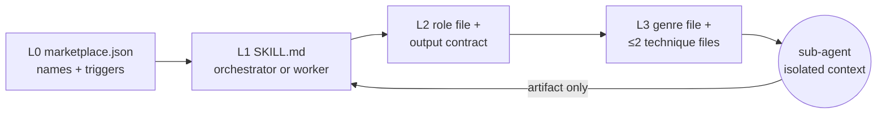
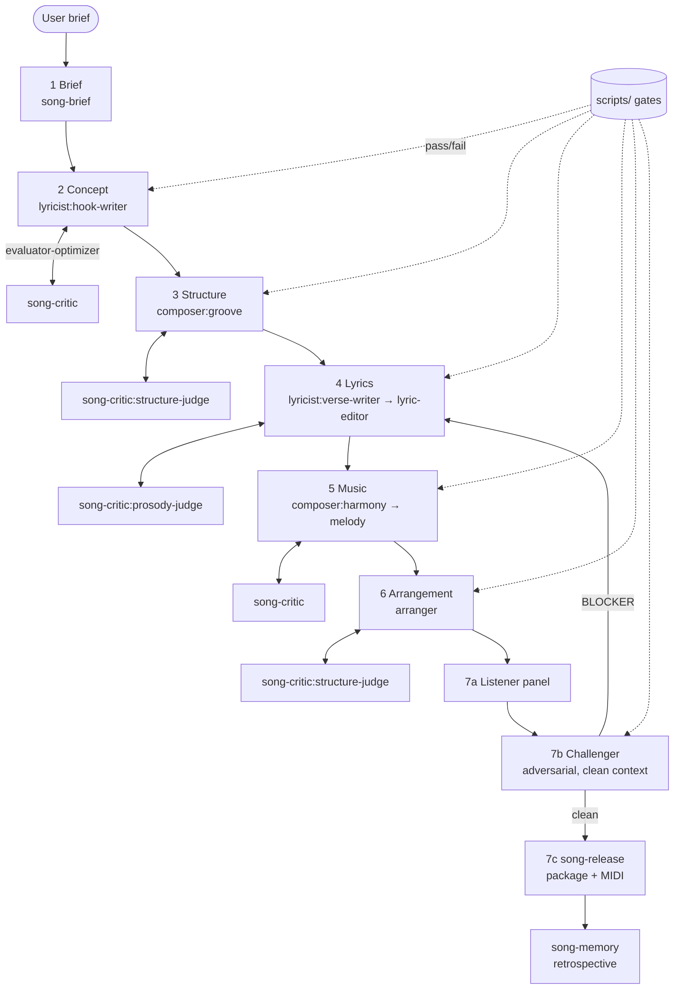

# song-team — Implementation Plan

> Status: **PROPOSED** · Author: Claude (with Michael Connelly) · Date: 2026-10-21
> Target plugin directory: `song-team/` · Marketplace ID: `song-team`
> Patterns borrowed from: `delivery-team/` (orchestrator + role-scoped workers + hooks), `mtg-commander/` (adversarial challengers, config-driven loops), `hardware-team/` (domain pipeline over a tool layer).

This document is the complete, self-contained plan for building a song-creation agent plugin. Every component, file, stage, hook, script, and governance obligation is specified here so a contributor can implement it wave by wave without re-deriving the design.

---

## Table of Contents

1. [Goals and Non-Goals](#1-goals-and-non-goals)
2. [Design Principles](#2-design-principles)
3. [Progressive Disclosure Model](#3-progressive-disclosure-model)
4. [Plugin Layout](#4-plugin-layout)
5. [Skill Roster](#5-skill-roster)
6. [The `song-flow` Pipeline](#6-the-song-flow-pipeline)
7. [Song Type Auto-Detection](#7-song-type-auto-detection)
8. [Collaboration Patterns](#8-collaboration-patterns)
9. [Artifacts and Output Contracts](#9-artifacts-and-output-contracts)
10. [Configuration Schema (`.song/config.yml` v1)](#10-configuration-schema-songconfigyml-v1)
11. [Hooks](#11-hooks)
12. [Scripts](#12-scripts)
13. [Reference Library (Progressive Disclosure Content)](#13-reference-library-progressive-disclosure-content)
14. [Memory and Self-Learning](#14-memory-and-self-learning)
15. [Guardrails: Originality and Copyright](#15-guardrails-originality-and-copyright)
16. [Governance Obligations](#16-governance-obligations)
17. [Implementation Waves](#17-implementation-waves)
18. [Definition of Done per Wave](#18-definition-of-done-per-wave)
19. [Risks and Mitigations](#19-risks-and-mitigations)
20. [Open Questions](#20-open-questions)
21. [Appendix A — Example Session Walkthrough](#appendix-a--example-session-walkthrough)
22. [Appendix B — Sub-Agent Prompt Template](#appendix-b--sub-agent-prompt-template)

---

## 1. Goals and Non-Goals

### Goals

- Deliver a **full song** (title, lyric sheet, chord chart, melody sketch, arrangement notes, production brief) from a one-line brief, through a staged pipeline with quality gates.
- Mirror the delivery-team architecture so contributors already familiar with `delivery-flow` can navigate `song-flow` immediately: one orchestrator, role-scoped worker skills, sub-agents with isolated context, hooks, config, memory.
- Load song-craft knowledge **progressively**: genre, role, and task references enter a sub-agent's context only when that sub-agent needs them. Never load the whole craft library at once.
- Produce **machine-checkable** artifacts where possible (ABC notation for melody, a structured lyric sheet with section tags, a chord chart in Roman numerals plus concert pitch) so hooks and scripts can validate rather than merely eyeball.
- Be **deterministic at the gates**: pass/fail decisions on prosody, rhyme scheme, structure, and originality are rule-based (scripts), not vibes.

### Non-Goals

- Audio rendering, mixing, or mastering. The pipeline ends at a production brief plus a MIDI/ABC sketch. DAW work is out of scope.
- Reproducing or closely imitating specific copyrighted songs or artists' lyrics. See [§15](#15-guardrails-originality-and-copyright).
- Music-theory tutoring as a primary purpose. Theory references exist to serve the pipeline, not as a standalone course.
- Replacing `delivery-team`. `song-team` is a sibling plugin, not a sub-skill of delivery-flow.

---

## 2. Design Principles

These are lifted from `delivery-team/references/shared/orchestrator-doctrine.md` and adapted.

1. **Orchestrator never writes the song.** `song-flow` coordinates stages and gates. Every lyric line, chord, and melody note is produced by a worker skill running as a sub-agent.
2. **Context isolation by role and genre.** A lyricist sub-agent working on a country ballad loads `lyricist/references/genres/country.md` and nothing about hip-hop. A composer sub-agent for the same song loads `composer/references/genres/country.md` and nothing about lyrics.
3. **Evaluator-optimizer at every creative stage.** A worker produces, a critic evaluates against an explicit rubric, the worker revises. Loop caps are configurable; exhaustion escalates to the user.
4. **Adversarial re-verification before release.** A challenger sub-agent with a clean context attempts to break the song (cliché density, prosody collisions, structural monotony, accidental resemblance to known works) before the final gate.
5. **Deterministic gates.** Scripts decide pass/fail on measurable properties. Sub-agents interpret and improve; they do not self-certify.
6. **Everything on disk.** Every stage writes to `.song/<song-slug>/` so a session can resume, a retrospective can read it, and memory can learn from it.
7. **Budgeted SKILL.md files.** Tier A/B/C line budgets apply exactly as in `governance/skill-budgets.json`. Depth lives in `references/`.

---

## 3. Progressive Disclosure Model

Four levels, each loaded strictly later than the previous.

| Level | What loads | When | Where |
|-------|-----------|------|-------|
| L0 — Metadata | Plugin + skill names, descriptions, trigger phrases | Always (marketplace index) | `.claude-plugin/marketplace.json` |
| L1 — Skill body | `SKILL.md` of the triggered skill (orchestrator or worker) | When the skill triggers | `song-team/skills/<skill>/SKILL.md` |
| L2 — Role / task reference | One role file (e.g. `roles/hook-writer.md`) + one task contract | When the worker dispatches a sub-agent for a specific task | `skills/<skill>/references/roles/`, `references/contracts/` |
| L3 — Genre / technique reference | One genre file and at most two technique files | Loaded inside the sub-agent prompt only | `skills/<skill>/references/genres/`, `references/techniques/` |

**Rule of two.** A sub-agent prompt may embed at most: one role file, one output contract, one genre file, two technique files. The `audit_agent_prompt.py` hook enforces this by counting `references/` paths in Agent tool prompts (see [§11](#11-hooks)).

**Shared references** (`song-team/references/shared/`) are the only files the orchestrator itself may load, and only the doctrine, stage-gate table, and config schema.



---

## 4. Plugin Layout

```
song-team/
├── README.md                       # user-facing: install, triggers, example sessions
├── ARCHITECTURE.md                 # contributor-facing: Mermaid diagrams, dispatch tables
├── CROSS-SKILL-REFERENCES.md       # which skill may load which shared reference
├── LICENSE.txt
├── .song.config.yml.example        # template copied to user repo as .song/config.yml
├── hooks/
│   ├── hooks.json
│   ├── check_config.py             # SessionStart: warn if .song/config.yml missing/stale
│   ├── telemetry.py                # PreToolUse(Skill): skill-load telemetry (copied pattern)
│   ├── audit_agent_prompt.py       # PreToolUse(Agent): rule-of-two + originality clause check
│   ├── validate_artifacts.py       # PostToolUse(Write|Edit): lyric-sheet / ABC / chord-chart lint
│   ├── gate_subagent.py            # SubagentStop(lyricist|composer|arranger): contract check
│   └── verify_skill_load.py        # PostToolUse(Agent): confirm sub-agent loaded its references
├── scripts/
│   ├── prosody_check.py            # syllable + stress alignment vs. section meter spec
│   ├── rhyme_check.py              # rhyme-scheme conformance, slant-rhyme tolerance
│   ├── structure_check.py          # section order/length vs. form template
│   ├── chord_tools.py              # key/scale validation, Roman <-> concert pitch, cadence lint
│   ├── abc_validate.py             # ABC notation parser + range/interval sanity
│   ├── midi_export.py              # ABC -> .mid (stdlib-only byte writer)
│   ├── cliche_scan.py              # phrase-frequency scan against references/shared/cliche-list.txt
│   └── resemblance_check.py        # n-gram overlap against user-supplied "do-not-resemble" corpus
├── references/
│   └── shared/
│       ├── orchestrator-doctrine.md
│       ├── stage-gates.md          # gate table: stage -> script -> threshold -> escalation
│       ├── config-schema.md        # single source of truth for .song/config.yml (v1)
│       ├── song-types.md           # auto-detection rules
│       ├── originality-policy.md   # the copyright guardrail, quoted verbatim in every prompt
│       ├── artifact-formats.md     # lyric sheet, chord chart, ABC, production brief specs
│       ├── cliche-list.txt
│       └── glossary.md
├── skills/
│   ├── song-flow/                  # Tier A — orchestrator
│   ├── song-brief/                 # Tier C — intake + concept (title, hook, theme, POV)
│   ├── lyricist/                   # Tier B — roles: hook-writer, verse-writer, lyric-editor
│   ├── composer/                   # Tier B — roles: harmony, melody, rhythm/groove
│   ├── arranger/                   # Tier B — roles: instrumentation, dynamics, production-brief
│   ├── song-critic/                # Tier B — roles: prosody-judge, structure-judge, listener-panel, challenger
│   ├── song-release/               # Tier C — assembles final package, exports MIDI, writes release notes
│   └── song-memory/                # Tier C — retrospective + memory write (post-pipeline protocol)
└── tests/
    ├── smoke/                      # 5-sample baseline like delivery-team BACKLOG-106
    └── fixtures/                   # sample briefs, expected gate outcomes
```

Each `skills/<name>/` directory follows:

```
skills/<name>/
├── SKILL.md
└── references/
    ├── roles/            # one file per role (L2)
    ├── contracts/        # output contracts, one per task type (L2)
    ├── genres/           # one file per genre (L3)
    ├── techniques/       # craft techniques (L3)
    └── agent-prompts/    # sub-agent prompt templates per task type
```

---

## 5. Skill Roster

| Skill | Tier | Budget | Role | Dispatches sub-agents? | Primary triggers |
|-------|------|--------|------|------------------------|------------------|
| `song-flow` | A | 500 | Orchestrator; runs the 7-stage pipeline, owns gates and loops | Yes (all workers) | "write a song", "song pipeline", "make me a song", "compose a song", "full song", "song from scratch" |
| `song-brief` | C | 200 | Intake wizard; produces the Brief artifact; detects song type | No (runs inline) | "song brief", "song idea", "what should the song be about" |
| `lyricist` | B | 300 | Hook, verse, pre-chorus, bridge lyrics; editing passes | Yes, role-scoped | "write lyrics", "chorus lyrics", "verse", "rewrite this lyric", "hook line", "rhyme this" |
| `composer` | B | 300 | Chord progressions, melody (ABC), groove/tempo | Yes, role-scoped | "chord progression", "write a melody", "key and tempo", "harmonize", "topline" |
| `arranger` | B | 300 | Instrumentation, section dynamics, production brief | Yes, role-scoped | "arrangement", "instrumentation", "production notes", "build the drop", "string arrangement" |
| `song-critic` | B | 300 | Rubric-driven critique, listener personas, adversarial challenger | Yes, role-scoped | "critique this song", "is this lyric good", "prosody check", "listener feedback", "song review" |
| `song-release` | C | 200 | Assembles the final package; runs exports; writes release notes | No | "export the song", "finalize song", "song package", "lead sheet" |
| `song-memory` | C | 200 | Retrospective + memory write; enforced by Stop hook | No | "song retrospective", "what did we learn" |

Each worker SKILL.md contains exactly: frontmatter (same keys as delivery-team: `tier`, `context_budget`, `fitness_review_due`, `maintainer`, `allowed-tools`), a **Design Principle** block, a **Role Detection** table, a **Dispatch Protocol** (which reference files to embed for which role), the **Output Contract** pointer, and a **Hand-off** section. Everything else lives in `references/`.

### Role tables per worker

**lyricist**

| Role | Detect when | Loads (L2) | Loads (L3) |
|------|-------------|-----------|-----------|
| `hook-writer` | task is chorus/hook/title line | `roles/hook-writer.md`, `contracts/hook.md` | `genres/<g>.md`, `techniques/hook-craft.md`, `techniques/prosody.md` |
| `verse-writer` | task is verse/pre-chorus/bridge | `roles/verse-writer.md`, `contracts/section-lyric.md` | `genres/<g>.md`, `techniques/imagery-and-specificity.md`, `techniques/rhyme-schemes.md` |
| `lyric-editor` | task is revise/tighten/fix-prosody | `roles/lyric-editor.md`, `contracts/revision.md` | `genres/<g>.md`, `techniques/prosody.md`, `techniques/cliche-avoidance.md` |

**composer**

| Role | Detect when | Loads (L2) | Loads (L3) |
|------|-------------|-----------|-----------|
| `harmony` | task is chords/progression/key | `roles/harmony.md`, `contracts/chord-chart.md` | `genres/<g>.md`, `techniques/functional-harmony.md`, `techniques/borrowed-chords.md` |
| `melody` | task is melody/topline | `roles/melody.md`, `contracts/melody-abc.md` | `genres/<g>.md`, `techniques/melodic-contour.md`, `techniques/range-and-tessitura.md` |
| `groove` | task is tempo/feel/rhythm | `roles/groove.md`, `contracts/groove-spec.md` | `genres/<g>.md`, `techniques/rhythmic-feel.md` |

**arranger**

| Role | Detect when | Loads (L2) | Loads (L3) |
|------|-------------|-----------|-----------|
| `instrumentation` | task is instruments/palette | `roles/instrumentation.md`, `contracts/arrangement-map.md` | `genres/<g>.md`, `techniques/section-contrast.md` |
| `dynamics` | task is energy curve/build/drop | `roles/dynamics.md`, `contracts/arrangement-map.md` | `genres/<g>.md`, `techniques/energy-curve.md` |
| `production-brief` | task is notes for a producer/DAW | `roles/production-brief.md`, `contracts/production-brief.md` | `genres/<g>.md`, `techniques/reference-track-language.md` |

**song-critic**

| Role | Detect when | Loads (L2) | Loads (L3) |
|------|-------------|-----------|-----------|
| `prosody-judge` | after any lyric stage | `roles/prosody-judge.md`, `contracts/critique.md` | `techniques/prosody.md` |
| `structure-judge` | after Structure and Arrangement stages | `roles/structure-judge.md`, `contracts/critique.md` | `techniques/form-templates.md` |
| `listener-panel` | before Release; review-board pattern | `roles/listener-panel.md`, `contracts/panel-report.md` | `personas/<3 selected>.md` |
| `challenger` | adversarial pass before Release | `roles/challenger.md`, `contracts/challenge-report.md` | `shared/originality-policy.md`, `shared/cliche-list.txt` |

---

## 6. The `song-flow` Pipeline

Seven stages, mirroring delivery-flow's count so the mental model transfers.

| # | Stage | Owner skill | Produces | Gate (deterministic) | Loop pattern |
|---|-------|-------------|----------|----------------------|--------------|
| 1 | **Brief** | `song-brief` | `brief.md` (theme, POV, audience, genre, mood, length, must/must-not) | Required fields present; song type detected | none (wizard) |
| 2 | **Concept** | `lyricist:hook-writer` + `song-critic` | `concept.md` (title, hook line, central image, emotional arc) | `cliche_scan.py` ≤ threshold; hook ≤ 12 syllables unless genre override | evaluator-optimizer (cap `loops.concept`) |
| 3 | **Structure** | `composer:groove` + `song-critic:structure-judge` | `structure.md` (form e.g. VCVCBC, bar counts, tempo, key, time sig, section meter spec) | `structure_check.py` vs. form template | evaluator-optimizer |
| 4 | **Lyrics** | `lyricist:verse-writer` then `lyricist:lyric-editor` + `song-critic:prosody-judge` | `lyrics.md` (tagged lyric sheet) | `prosody_check.py` + `rhyme_check.py` pass; `cliche_scan.py` ≤ threshold | evaluator-optimizer (cap `loops.lyrics`) |
| 5 | **Music** | `composer:harmony` then `composer:melody` + `song-critic` | `chords.md`, `melody.abc` | `chord_tools.py` validates key/diatonic ratio; `abc_validate.py` parses, range within tessitura | evaluator-optimizer; **debate** if harmony and melody roles disagree on key |
| 6 | **Arrangement** | `arranger` (all three roles) + `song-critic:structure-judge` | `arrangement.md`, `production-brief.md` | Section energy curve monotonic-rising to climax then resolves (script check) | evaluator-optimizer |
| 7 | **Release** | `song-critic:listener-panel` → `song-critic:challenger` → `song-release` | `package/` (lyric sheet, lead sheet, `.mid`, brief, release notes) | Challenger report has zero BLOCKER findings; `resemblance_check.py` below threshold | review board + adversarial; escalate on unresolved BLOCKER |



### Stage execution protocol (identical for every stage)

1. Orchestrator reads `.song/config.yml` and `.song/<slug>/state.json`.
2. Orchestrator builds a sub-agent prompt from the worker's `agent-prompts/<task>.md` template, embedding only the files permitted by the role table.
3. Sub-agent writes the artifact to `.song/<slug>/<artifact>` and returns a ≤ 20-line summary.
4. Orchestrator runs the stage's gate script(s). On fail, it dispatches the critic role with the script output as evidence, then re-dispatches the worker with the critique. Loop until pass or cap.
5. On cap exhaustion: escalate to the user with the last three attempts and the gate diff. The user picks: accept, override gate (recorded in `state.json`), or supply guidance.
6. Orchestrator updates `state.json` and proceeds.

### Stage skipping by song type

See [§7](#7-song-type-auto-detection). `LYRICS_ONLY` skips 5 and 6; `INSTRUMENTAL` skips 2 and 4; `TOPLINE` treats 3 and 5-harmony as given input.

---

## 7. Song Type Auto-Detection

Documented in `references/shared/song-types.md`. Detection runs in Stage 1 from the brief text; `routing.force_type` in config pins it.

| Type | Signals | Stages run | Notes |
|------|---------|-----------|-------|
| `FULL_SONG` | default | 1–7 | |
| `LYRICS_ONLY` | "just lyrics", "words only", no mention of chords/melody | 1,2,3(light),4,7 | Structure stage still sets meter spec |
| `INSTRUMENTAL` | "instrumental", "no vocals", "beat", "theme music" | 1,3,5,6,7 | Concept becomes "motif" instead of hook |
| `TOPLINE` | user supplies chords/track; "write over this", "topline" | 1,2,4,5(melody only),7 | Harmony is input, validated not generated |
| `REWRITE` | user supplies existing original lyric; "fix", "tighten", "second draft" | 1,4(editor only),7 | Originality check runs on the input first |
| `JINGLE` | "jingle", "ad", "30 seconds", brand name present | 1,2,3,4,5,7 | Hard length cap; structure template `jingle` |
| `PARODY_ADAPT` | "parody", "to the tune of", "in the style of <song>" | **blocked** | Refused with explanation; see §15. "In the style of <genre>" is fine and routes to FULL_SONG |

---

## 8. Collaboration Patterns

Reused from delivery-team; each has a defined trigger, participants, and exit.

| Pattern | Trigger | Participants | Exit |
|---------|---------|--------------|------|
| Evaluator-optimizer | every creative stage | worker role ↔ critic role | gate script passes or loop cap |
| Adversarial review | Stage 7b always; Stage 4 if `quality.adversarial_lyrics: true` | challenger (clean context, never saw drafts) | zero BLOCKER findings |
| Review board | Stage 7a | 3 listener personas chosen by genre + audience from `song-critic/references/personas/` | panel report with majority verdict |
| Debate | key/tempo disagreement between harmony and melody roles; hook A/B tie | two advocates + orchestrator as judge using rubric in `shared/stage-gates.md` | written decision with rationale in `decisions.md` |
| Decision ownership | every stage artifact has one owning role recorded in `state.json` | — | — |
| Consensus | Stage 6 instrumentation must agree with Stage 3 tempo/key and Stage 5 range | arranger + composer summaries compared by script `structure_check.py --consistency` | diff empty |

Escalation ladder (from `config.escalation`): retry → critic-guided retry → debate (if two roles) → user.

---

## 9. Artifacts and Output Contracts

All artifacts are Markdown or plain-text so hooks can lint them. Specs live in `references/shared/artifact-formats.md`. Summary:

| Artifact | Path (`.song/<slug>/`) | Format essentials |
|----------|------------------------|-------------------|
| Brief | `brief.md` | YAML front-matter: `theme, pov, audience, genre, mood, target_length_sec, must_include[], must_avoid[], song_type` |
| Concept | `concept.md` | `title`, `hook_line`, `central_image`, `arc: [start, turn, end]`, `title_rationale` |
| Structure | `structure.md` | table: `section, label, bars, meter_spec (syllables per line + stress pattern), rhyme_scheme`; plus `key, mode, bpm, time_sig` |
| Lyrics | `lyrics.md` | `[Verse 1]`, `[Chorus]` … tags exactly matching `structure.md`; one line per lyric line; `# ` comments allowed |
| Chords | `chords.md` | per section: Roman numerals + concert chords, one bar per `|` cell, e.g. `| I | V | vi | IV |` |
| Melody | `melody.abc` | ABC 2.1, one voice, lyrics aligned with `w:` lines, `K:` and `M:` matching `structure.md` |
| Arrangement | `arrangement.md` | table: `section, energy(1-10), instruments_in, instruments_out, texture_note` |
| Production brief | `production-brief.md` | reference-free language (no "sounds like <artist>"), tempo map, vocal treatment, mix priorities |
| Package | `package/` | `lyric-sheet.md`, `lead-sheet.abc`, `song.mid`, `one-pager.md`, `release-notes.md` |
| State | `state.json` | `stage, song_type, loops_used{}, gate_overrides[], owners{}, started, updated` |
| Decisions | `decisions.md` | debate outcomes and user overrides, append-only |

Output contracts (`skills/*/references/contracts/*.md`) each specify: required headings, forbidden content (artist names, quoted existing lyrics), max length, and the exact gate script that will be run against the output.

---

## 10. Configuration Schema (`.song/config.yml` v1)

Source of truth: `song-team/references/shared/config-schema.md`. Extension protocol identical to delivery-team's: bump minor for additive keys, major for breaking, document migration in the schema file.

```yaml
schema_version: 1

routing:
  force_type: null            # FULL_SONG | LYRICS_ONLY | INSTRUMENTAL | TOPLINE | REWRITE | JINGLE
  default_genre: null         # used when brief omits genre

loops:
  concept: 3
  structure: 2
  lyrics: 4
  music: 3
  arrangement: 2
  release: 2

quality:
  cliche_max_per_100_words: 2
  prosody_tolerance: 0.15     # fraction of stressed-syllable mismatches allowed per section
  slant_rhyme_allowed: true
  diatonic_min_ratio: 0.6     # fraction of chords that must be diatonic unless genre overrides
  adversarial_lyrics: false   # run challenger after Stage 4 too, not only Stage 7
  listener_panel_size: 3

originality:
  resemblance_corpus: []      # paths to user-supplied lyric files the song must not resemble
  ngram_max_overlap: 0.05
  block_artist_references: true

escalation:
  on_loop_exhaustion: ask_user   # ask_user | accept_best | fail
  on_blocker: ask_user

memory:
  enabled: true
  path: .song/memory/

telemetry:
  enabled: true
```

The setup wizard (in `song-brief`) asks at most **6 questions**: genre, mood, theme, audience, length, anything-to-avoid. Everything else defaults.

---

## 11. Hooks

`song-team/hooks/hooks.json`. All scripts are stdlib-only Python, exit 0 on allow, print JSON `{decision, reason}` per the hook contract. Build each with `plugin-dev:hook-development` loaded.

| Event | Matcher | Hook | Purpose |
|-------|---------|------|---------|
| `SessionStart` | `*` | `check_config.py` | Warn if `.song/config.yml` missing or `schema_version` behind; never block |
| `PreToolUse` | `Skill` | `telemetry.py` | Record skill loads (copied from delivery-team, path-adjusted) |
| `PreToolUse` | `Skill` | prompt hook | If `song-team:lyricist`/`composer`/`arranger` invoked without `.song/config.yml`, warn (not deny) that gates will not run; "skip pipeline" bypasses |
| `PreToolUse` | `Agent` | `audit_agent_prompt.py` | Enforce rule-of-two reference loading; require the originality clause verbatim; deny if prompt names a real artist or quotes a known song title as a style target |
| `PostToolUse` | `Write\|Edit` | `validate_artifacts.py` | If path matches `.song/**/lyrics.md`, `chords.md`, `melody.abc`, `structure.md`: run the matching lint script and surface errors as hook output |
| `PostToolUse` | `Agent` | `verify_skill_load.py` | Confirm the sub-agent reported which reference files it loaded; mismatch is logged |
| `SubagentStop` | `lyricist\|composer\|arranger` | `gate_subagent.py` | Run the stage's gate script on the artifact just produced; block with reason on fail so the orchestrator loops |
| `Stop` | `*` | prompt hook | If `.song/<slug>/state.json` exists with `stage >= 7` and no `retrospective.md`, block: "Post-pipeline protocol not completed" (same as delivery-team) |

---

## 12. Scripts

All in `song-team/scripts/`, stdlib-only, `python -I`-safe, each with `--json` output and a `--help`. Each has a unit test in `tests/`.

| Script | Input | Output | Used by |
|--------|-------|--------|---------|
| `prosody_check.py` | `lyrics.md`, `structure.md` | per-line syllable count and stress-mismatch ratio vs. meter spec; PASS/FAIL | Stage 4 gate, `validate_artifacts.py` |
| `rhyme_check.py` | `lyrics.md`, `structure.md` | rhyme-scheme conformance per section, slant rhymes flagged | Stage 4 gate |
| `structure_check.py` | `structure.md`, optionally `lyrics.md`/`arrangement.md` | form-template conformance; `--consistency` cross-checks key/bpm/range across artifacts | Stages 3, 6, consensus |
| `chord_tools.py` | `chords.md` + key | diatonic ratio, Roman↔concert conversion, cadence lint, voice-leading warnings | Stage 5 gate |
| `abc_validate.py` | `melody.abc` | parse errors, pitch range, max leap, lyric-syllable alignment vs. `lyrics.md` | Stage 5 gate |
| `midi_export.py` | `melody.abc`, `chords.md` | `song.mid` (melody track + block-chord track), written with raw MIDI bytes | Stage 7 |
| `cliche_scan.py` | any lyric text | hits per 100 words against `shared/cliche-list.txt` | Stages 2, 4, challenger |
| `resemblance_check.py` | lyric text + corpus paths | max n-gram overlap ratio | Stage 7b |

Syllable and stress estimation uses a heuristic (vowel-group counting with a 200-entry exception table plus simple stress rules). Accuracy target ≥ 90% on the fixture set; the tolerance knob absorbs the rest. No external dictionaries or packages.

---

## 13. Reference Library (Progressive Disclosure Content)

Everything a sub-agent might read. Each file ≤ 150 lines; genre files ≤ 100.

### `references/shared/` (orchestrator-visible)
`orchestrator-doctrine.md`, `stage-gates.md`, `config-schema.md`, `song-types.md`, `originality-policy.md`, `artifact-formats.md`, `cliche-list.txt`, `glossary.md`.

### `skills/lyricist/references/`
- `roles/`: `hook-writer.md`, `verse-writer.md`, `lyric-editor.md`
- `contracts/`: `hook.md`, `section-lyric.md`, `revision.md`
- `techniques/`: `prosody.md`, `rhyme-schemes.md`, `hook-craft.md`, `imagery-and-specificity.md`, `cliche-avoidance.md`, `point-of-view.md`, `narrative-arc.md`
- `genres/`: `pop.md`, `rock.md`, `country.md`, `folk.md`, `hip-hop.md`, `rnb.md`, `electronic.md`, `musical-theatre.md`, `childrens.md`, `worship.md` (each: lyric conventions, typical rhyme density, taboo moves, section lengths)
- `agent-prompts/`: `hook.md`, `section.md`, `revision.md`

### `skills/composer/references/`
- `roles/`: `harmony.md`, `melody.md`, `groove.md`
- `contracts/`: `chord-chart.md`, `melody-abc.md`, `groove-spec.md`
- `techniques/`: `functional-harmony.md`, `borrowed-chords.md`, `melodic-contour.md`, `range-and-tessitura.md`, `rhythmic-feel.md`, `abc-notation-primer.md`, `modal-color.md`
- `genres/`: same ten genre names (each: common progressions in Roman numerals, tempo bands, feel, typical keys, melodic idioms)
- `agent-prompts/`: `harmony.md`, `melody.md`, `groove.md`

### `skills/arranger/references/`
- `roles/`: `instrumentation.md`, `dynamics.md`, `production-brief.md`
- `contracts/`: `arrangement-map.md`, `production-brief.md`
- `techniques/`: `section-contrast.md`, `energy-curve.md`, `reference-track-language.md` (how to describe a sound without naming artists), `vocal-production.md`
- `genres/`: same ten (each: palette, typical energy curve, production tropes)
- `agent-prompts/`: `arrangement.md`, `production-brief.md`

### `skills/song-critic/references/`
- `roles/`: `prosody-judge.md`, `structure-judge.md`, `listener-panel.md`, `challenger.md`
- `contracts/`: `critique.md`, `panel-report.md`, `challenge-report.md`
- `rubrics/`: `hook-rubric.md`, `lyric-rubric.md`, `melody-rubric.md`, `arrangement-rubric.md` (each 5 criteria × 1–5 scale, with the threshold the gate expects)
- `personas/`: 12 listener personas (e.g. `casual-radio-listener.md`, `lyric-first-listener.md`, `dancefloor.md`, `musician-peer.md`, `sync-licensing-supervisor.md`, `parent-of-young-kids.md`, `worship-leader.md`, `playlist-curator.md` …); each: what they notice, what makes them skip, the questions they ask
- `techniques/`: `form-templates.md` (VCVCBC, AABA, verse-refrain, jingle, EDM build-drop, through-composed), `prosody.md` (symlinked copy of lyricist's to keep contexts independent)

### `skills/song-brief/references/`
`intake-questions.md`, `song-types.md` (pointer to shared), `brief-template.md`.

### `skills/song-release/references/`
`package-layout.md`, `lead-sheet-conventions.md`, `release-notes-template.md`.

### `skills/song-memory/references/`
`retrospective-template.md`, `memory-schema.md`.

Every reference file begins with a 3-line frontmatter: `loaded_by:` (which role), `level:` (L2/L3), `last_reviewed:`.

---

## 14. Memory and Self-Learning

Pattern copied from `.delivery/memory/`.

- `song-memory` runs after Stage 7 (enforced by the Stop hook). It writes `.song/memory/<date>-<slug>.md` containing: genre, song type, loops used per stage, which gate failed most, what critique recurred, user overrides, and three "next time" notes.
- At Stage 1, `song-flow` reads the last five memory files for the same genre and injects a ≤ 10-line "lessons" block into the Stage 2 and Stage 4 sub-agent prompts. This is the one exception to the rule-of-two and is labelled as such.
- Memory never stores lyric text, only observations about process.

---

## 15. Guardrails: Originality and Copyright

Documented verbatim in `references/shared/originality-policy.md` and embedded in every creative sub-agent prompt. `audit_agent_prompt.py` denies any Agent prompt missing the clause.

1. Never reproduce, closely paraphrase, or "write in the exact style of" an identifiable existing song or artist. Genre and era are fine; named artists and song titles as targets are not.
2. `PARODY_ADAPT` requests are refused with a one-sentence explanation and an offer to write an original song on the same theme.
3. Production briefs describe sound with technical language, not "sounds like <artist>".
4. `resemblance_check.py` runs against any corpus the user supplies and against `cliche-list.txt`; the challenger role additionally reports any line it recognises as a well-known lyric.
5. User-supplied input for `REWRITE`/`TOPLINE` must be asserted by the user as their own original work; the wizard asks once and records the answer in `brief.md`.

---

## 16. Governance Obligations

Checklist to be satisfied before the plugin is registered.

- [ ] Register in `.claude-plugin/marketplace.json` with all eight skill paths; bump marketplace `metadata.version` minor.
- [ ] Add all eight SKILL.md entries to `governance/skill-budgets.json` with tiers from §5. No `known_debt` entries at launch.
- [ ] Set `fitness_review_due` in each SKILL.md to launch date + 90 days.
- [ ] `song-team/ARCHITECTURE.md` with at least: component diagram, pipeline diagram, dispatch sequence diagram, hook table, script table.
- [ ] `song-team/README.md` with install, triggers, the 6-question wizard, two example sessions, and the originality policy summary.
- [ ] `CLAUDE.md` plugin table row and `docs/skills/` index entry.
- [ ] `CHANGELOG.md` entry.
- [ ] CI: `skill-line-budget.yml` passes; `workflow-injection-lint.yml` untouched.
- [ ] Run `plugin-dev:skill-reviewer` on every SKILL.md and `plugin-dev:plugin-validator` on the plugin before the PR is marked ready.
- [ ] `tests/smoke/` 5-sample baseline (reuse delivery-team's smoke-test runner pattern from BACKLOG-106/107).

---

## 17. Implementation Waves

Each wave is a separate PR. Stories are sized for one session each.

### Wave 0 — Scaffold and governance (2 stories)
- **W0-1** Create `song-team/` skeleton, LICENSE, README stub, ARCHITECTURE stub, marketplace registration, budgets registration, CLAUDE.md row. Validator passes on empty skills.
- **W0-2** Write `references/shared/*` (doctrine, stage-gates, config-schema v1, song-types, originality-policy, artifact-formats, glossary, cliche-list seed of 150 phrases).

### Wave 1 — Scripts and gates (4 stories)
- **W1-1** `prosody_check.py` + `rhyme_check.py` + fixtures + tests.
- **W1-2** `structure_check.py` + `cliche_scan.py` + `resemblance_check.py` + tests.
- **W1-3** `chord_tools.py` + `abc_validate.py` + tests.
- **W1-4** `midi_export.py` + round-trip test (ABC → MIDI → parse header/track lengths).

### Wave 2 — Worker skills, lyric side (3 stories)
- **W2-1** `song-brief` SKILL.md + references + wizard; detection table implemented.
- **W2-2** `lyricist` SKILL.md, three roles, three contracts, seven techniques, three agent-prompts, pop + country + folk genre files.
- **W2-3** `song-critic` SKILL.md, `prosody-judge` + `structure-judge` roles, lyric/hook rubrics, four personas, `form-templates.md`.

### Wave 3 — Worker skills, music side (3 stories)
- **W3-1** `composer` SKILL.md, three roles, contracts, techniques including ABC primer, same three genre files.
- **W3-2** `arranger` SKILL.md, three roles, contracts, techniques, same three genre files.
- **W3-3** `song-critic` additions: melody/arrangement rubrics, `listener-panel` + `challenger` roles, remaining eight personas.

### Wave 4 — Orchestrator, hooks, release (4 stories)
- **W4-1** `song-flow` SKILL.md: stage protocol, gate table wiring, loop/escalation handling, song-type routing, `state.json` management.
- **W4-2** `hooks/hooks.json` + six hook scripts, built with `plugin-dev:hook-development`.
- **W4-3** `song-release` + `song-memory` skills; Stop-hook enforcement verified end-to-end.
- **W4-4** Smoke-test baseline: five briefs (one per song type except PARODY_ADAPT, which is a refusal test) run end-to-end; record loops-used and gate-pass rates as the baseline.

### Wave 5 — Breadth and polish (3 stories)
- **W5-1** Remaining seven genre files × three skills (21 files).
- **W5-2** `ARCHITECTURE.md` final diagrams, `CROSS-SKILL-REFERENCES.md`, README example sessions.
- **W5-3** Skill reviewer + plugin validator pass on everything; fitness-review dates set; CHANGELOG; version bump.

Estimated total: **19 stories**, five PRs.

---

## 18. Definition of Done per Wave

| Wave | DoD |
|------|-----|
| 0 | Validator passes; budgets CI green; every shared reference has frontmatter; cliche-list ≥ 150 entries |
| 1 | Every script: `--help`, `--json`, unit tests pass under `python -I`; fixture accuracy ≥ 90% for prosody |
| 2 | Each SKILL.md within budget; every role file ≤ 150 lines; `lyricist` can produce a gate-passing chorus for a pop brief in ≤ 3 loops when invoked standalone |
| 3 | `composer` produces a parseable `melody.abc` aligned to a fixture `lyrics.md`; `arranger` output passes `structure_check.py --consistency` |
| 4 | Full `FULL_SONG` run on the pop fixture completes without user intervention; Stop hook blocks when retrospective missing; `audit_agent_prompt.py` denies an artist-named prompt |
| 5 | All ten genres present in all three worker skills; skill-reviewer has no HIGH findings; README examples reproduce |

---

## 19. Risks and Mitigations

| Risk | Impact | Mitigation |
|------|--------|-----------|
| Heuristic syllable/stress counting is noisy | False gate failures, loop exhaustion | Tolerance knob; exception table grows from fixtures; prosody-judge sees script output and can recommend override with reason |
| ABC melody output from a language model is frequently malformed | Stage 5 loops | `abc-notation-primer.md` with strict subset; `abc_validate.py` returns line-precise errors fed back into the loop |
| Sub-agents drift into naming artists | Policy violation | Hook denial + challenger role + `block_artist_references` default true |
| Reference library balloons past budgets | Context bloat defeats progressive disclosure | Hard per-file line caps enforced by a lint added to `scripts/check_skill_budgets.py` scope (W0-1 proposes extending it to `references/**` with a 150-line cap for this plugin) |
| Genre files become opinionated and stale | Poor output in some genres | Each genre file carries `last_reviewed`; fitness review covers them |
| Seven stages feel heavy for a quick lyric | Users bypass the pipeline | `LYRICS_ONLY` and `REWRITE` paths run 3–4 stages; standalone worker invocation remains allowed with a warning, not a denial |

---

## 20. Open Questions

Decisions the author took by default; flag if you disagree.

1. **Plugin name** `song-team` (vs. `song-creator`, `songwriter`). Chosen for parallelism with `delivery-team` / `hardware-team`.
2. **ABC notation** as the melody format (vs. MusicXML or MIDI-only). Chosen because it is text, lintable, and representable by a language model; `midi_export.py` bridges to binary.
3. **Ten launch genres.** Expandable; the list is a judgment call.
4. **No audio.** Confirmed non-goal; could become a later wave via an external MCP server if one exists.
5. **Standalone worker invocation warns rather than denies** (delivery-team denies for implementation skills). Songwriting is lower-stakes than shipping code, so friction is reduced.

---

## Appendix A — Example Session Walkthrough

User: *"Write me an upbeat indie-pop song about moving to a new city and not knowing anyone yet."*

1. `song-flow` triggers. No `.song/config.yml`; `check_config.py` warned at session start. Orchestrator invokes `song-brief`, which asks the remaining questions (audience: 20s–30s; length: ~3:00; avoid: "no mention of specific cities"). Writes `brief.md`, detects `FULL_SONG`, genre `pop` with sub-tag `indie`.
2. Concept: `lyricist:hook-writer` sub-agent loads `roles/hook-writer.md`, `contracts/hook.md`, `genres/pop.md`, `techniques/hook-craft.md`, `techniques/prosody.md`, the originality clause, and a 6-line lessons block from memory. Returns title *"Nobody Knows My Name Here (Yet)"* with hook line and arc. `cliche_scan.py` reports 0.9/100 → pass.
3. Structure: `composer:groove` sets 118 bpm, 4/4, key D major, form `V1 PC C V2 PC C B C C`, meter spec per section. `structure_check.py` passes.
4. Lyrics: `verse-writer` drafts; `prosody_check.py` flags 22% stress mismatch in Verse 2 (tolerance 15%). `prosody-judge` critiques; `lyric-editor` revises; second run 9% → pass. `rhyme_check.py` passes with two slant rhymes allowed.
5. Music: `harmony` writes `| I | V | vi | IV |` verse and a `IV | I | V | V` pre-chorus lift; `melody` writes ABC with `w:` lyric alignment. `abc_validate.py` flags one leap > an octave; one loop; pass.
6. Arrangement: energy curve 3-5-7-4-6-8-5-9-9; script passes; production brief written.
7. Release: three personas (casual-radio, playlist-curator, lyric-first) report; challenger finds one MINOR (bridge rhyme too predictable) and zero BLOCKERs. `song-release` assembles `package/` and exports `song.mid`. `song-memory` writes the retrospective; Stop hook approves.

---

## Appendix B — Sub-Agent Prompt Template

Every `agent-prompts/*.md` follows this skeleton. The orchestrator substitutes the bracketed parts.

```
You are the {role} for song-team, working on "{title}" ({genre}, {song_type}).

## Originality policy (verbatim, non-negotiable)
{contents of references/shared/originality-policy.md}

## Your role
{contents of roles/{role}.md}

## Output contract
{contents of contracts/{contract}.md}
Write the artifact to: {artifact_path}

## Genre guidance
{contents of genres/{genre}.md}

## Techniques (max 2)
{contents of techniques/{t1}.md}
{contents of techniques/{t2}.md}

## Inputs from earlier stages
{brief.md} {structure.md} {previous artifact if revising}

## Critique to address (if any)
{critique text and gate script output}

## Lessons from memory (≤10 lines)
{lessons block}

## Return
Write the artifact, then reply with ≤20 lines: what you produced, which reference
files you loaded (list paths), and any decision you want the orchestrator to record.
```
