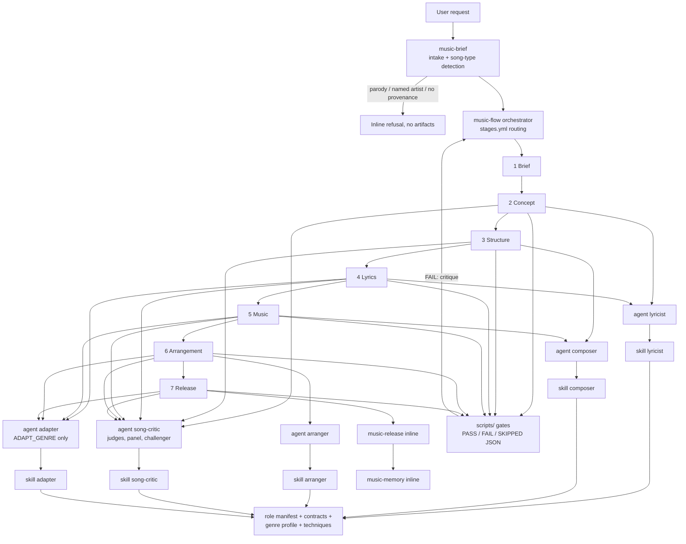

# music-team Architecture

music-team (renamed from song-team) is a song-creation, music-theory and cross-genre adaptation plugin built on the delivery-team pattern: named agent shells, role skills with Phase-1 detection, and progressive disclosure so a sub-agent only ever sees the role manifest and references it needs.

The runtime data directory stays `.song/` by design (it is a data format, not the plugin name), so existing `.song/` projects keep working after the rename.

## System flow



## One dispatch

```mermaid
sequenceDiagram
    participant O as music-flow
    participant PRE as PreToolUse<br/>audit_agent_prompt.py
    participant A as Agent shell (e.g. lyricist)
    participant W as Worker skill
    participant POST as PostToolUse<br/>verify_skill_loaded.py
    participant STOP as SubagentStop<br/>subagent_gate.py
    participant G as Gate scripts
    O->>O: build prompt (shell + policy + role manifest + refs + inputs + lessons)
    O->>PRE: Agent call
    PRE-->>O: allow, or block (missing originality block, blocked target, disallowed reference)
    O->>A: dispatch
    A->>W: Phase 1 detection (haiku), then role manifest only
    W-->>A: artifact written under .song/slug
    A->>STOP: agent stops
    STOP->>G: run the role's gates
    STOP-->>O: advisory gate summary
    A-->>O: hand-back: SKILL_LOADED refs + SUMMARY
    O->>POST: tool result
    POST-->>O: warn if SKILL_LOADED is missing or mismatched
    O->>G: authoritative gate run
    G-->>O: PASS or FAIL JSON
    O->>O: PASS advances; FAIL re-dispatches with critique (loop cap)
```

The hooks are advisory and fail open; the orchestrator's own gate run is the decision.

## Agent, skill, progressive disclosure

1. `agents/*.md` (lyricist, composer, arranger, song-critic, adapter) are thin shells with `model: sonnet` and no craft knowledge. They exist so the SubagentStop matcher fires per role.
2. Each worker skill (`skills/<role>/SKILL.md`) performs Phase-1 detection (`phase_1_detector_model: haiku`) to pick a role and task type, then reads only that role's manifest under `references/roles/`.
3. The orchestrator pastes the matched manifest, its output contract, the genre profile section for that role, and the techniques allowed by `references/shared/prompt-allowances.json` into the sub-agent prompt. Other roles and genres never load.
4. The sub-agent replies `SKILL_LOADED:` listing every reference path it embedded; the PostToolUse hook checks this.

## Skills

| Skill | Role |
|-------|------|
| `music-flow` | Orchestrator: routing from `stages.yml`, dispatch, gates, loops, state |
| `music-brief` | Intake wizard, song-type detection, provenance and refusal handling |
| `lyricist` | hook-writer, verse-writer, lyric-editor, augmenter |
| `composer` | groove (structure), harmony, melody (ABC), theorist (THEORY answers) |
| `arranger` | instrumentation and production brief |
| `adapter` | lyric-adapter, music-adapter, adaptation report (ADAPT_GENRE) |
| `song-critic` | rubric judges, listener-panel personas, challenger |
| `music-release` | Package assembly and MIDI export (inline) |
| `music-memory` | Retrospective and lessons (inline) |

## Song types and stages

Source of truth: `references/shared/song-types.md`. F full with loops, L light, I input supplied by user, - skipped.

| Type | 1 | 2 | 3 | 4 | 5 | 6 | 7 |
|------|---|---|---|---|---|---|---|
| FULL_SONG | F | F | F | F | F | F | F |
| LYRICS_ONLY | F | F | L | F | - | - | L |
| INSTRUMENTAL | F | L | F | - | F | F | F |
| TOPLINE | F | F | I | F | L | - | L |
| THEORY | F | - | - | - | - | - | - |
| ADAPT_GENRE | F | I | I | L | I | I | F |
| AUGMENT_LYRICS | F | I | I | L | - | - | L |
| REWRITE | F | - | L | F | - | - | L |
| JINGLE | F | F | F | F | F | L | F |
| REVISE | - | per request | per request | per request | per request | per request | F |
| PARODY_ADAPT | refused | | | | | | |

That is 11 rows: 10 runnable types plus PARODY_ADAPT, which is detected and refused. THEORY dispatches a single `composer` `theorist` and answers inline. ADAPT_GENRE runs stages 4-6 through `adapter` and adds Stage 7p `adaptation-report.md`. AUGMENT_LYRICS runs `lyricist` role `augmenter` only.

## Gate scripts

All stdlib-only, run with `python3 -I`, sharing the `gate_common.py` contract (JSON result, thresholds from `.song/config.yml`).

| Script | Gates |
|--------|-------|
| `cliche_scan.py` | cliche density in concept.md / lyrics.md |
| `prosody_check.py` | hook (Stage 2) and lyric (Stage 4) prosody vs meter spec |
| `rhyme_check.py` | rhyme scheme vs structure |
| `structure_check.py` | form template; `--consistency` across all artifacts |
| `chord_tools.py` | chord spelling, transposition, Roman numerals, reharmonization, chords.md gate |
| `abc_validate.py` | melody.abc validity and lyric alignment |
| `arrangement_check.py` | arrangement.md |
| `adapt_check.py` | adaptation-report.md dispositions (kept vs changed) |
| `challenge_gate.py` | BLOCKER rows in challenge-report.md |
| `resemblance_check.py` | opt-in word 5-gram overlap with a resemblance corpus |

Utilities (14 scripts in total): `gate_common.py`, `midi_export.py` (hand-written Standard MIDI File writer for the package), `validate_stages.py` (checks `stages.yml` against its schema), `check_reference_caps.py` (reference-size lint). `validate_artifacts.py` (planned artist-name lint for production-brief.md) is not built.

## Hooks

Defined in `hooks/hooks.json`; all act only on music-team dispatches and fail open.

| Event | Matcher | Script | Behaviour |
|-------|---------|--------|-----------|
| PreToolUse | Agent | `audit_agent_prompt.py` | Audits sub-agent prompts: originality block present, blocked targets, per-role reference allowances |
| PostToolUse | Agent | `verify_skill_loaded.py` | Verifies the hand-back `SKILL_LOADED:` line against embedded references |
| SubagentStop | lyricist, composer, arranger, song-critic, adapter | `subagent_gate.py --agent <name>` | Runs that role's gates and surfaces an advisory summary |

There is no Stop hook: the orchestrator itself verifies that `retrospective.md` frontmatter `run_id` equals `state.json.run_id` before setting status complete.

## Genre profiles

`references/shared/genres/` holds 12 profiles: blues, bossa-nova, country, electronic, folk, gospel, hip-hop, jazz, musical-theatre, pop, rnb, rock. Each has Identity, Lyric, Harmony, Rhythm, Arrangement and Adaptation notes sections; the orchestrator pastes only the section for the dispatched role (for ADAPT_GENRE, both source and target genres).

## Originality and provenance

`references/shared/originality-policy.md` is embedded verbatim in every worker prompt. Genre and era are valid targets; named artists and songs are not. Parody, "to the tune of" and named-artist requests (PARODY_ADAPT) are refused with an offer to write an original. TOPLINE, REWRITE, ADAPT_GENRE and AUGMENT_LYRICS require `user_asserts_original_input: true`, or `public_domain: true` with `public_domain_source`. `blocked-targets.txt` is checked on targets, the challenger role reviews every finished song, and the resemblance corpus check is opt-in.

## Runtime layout

```
.song/
  config.yml            # per-project settings
  active                # slug pointer
  memory/               # lessons across runs
  <slug>/               # state.json, brief.md, concept.md, structure.md, lyrics.md,
                        # chords.md, melody.abc, arrangement.md, production-brief.md,
                        # adaptation-report.md, panel-report.md, challenge-report.md,
                        # critiques/, package/, retrospective.md, decisions.md
```

## Models

Every agent shell and worker skill pins `model: sonnet`; Phase-1 detection runs on `haiku` (`phase_1_detector_model`).

## Testing

```
python3 -I -m unittest discover -s music-team/tests/unit -t music-team
python3 -I music-team/scripts/check_reference_caps.py
python3 scripts/check_skill_budgets.py
```
